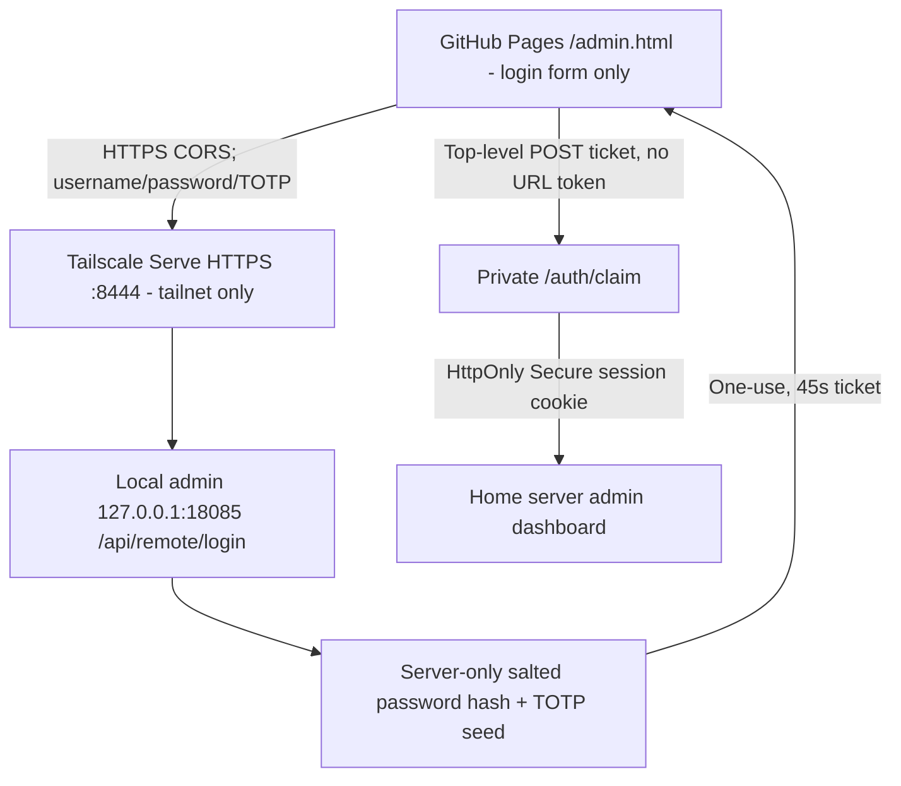

# GitHub Pages → Tailscale HTTPS → Home Server Admin (ID / Password / Google OTP)

This is an **owner-only administrator gateway**. GitHub Pages hosts a login **form only** at `https://heh-heh.github.io/market-career-dashboard/admin.html`; every credential is checked by the home server. **No user ID, password, TOTP secret or long-lived session is committed to GitHub.** The password is stored as PBKDF2-SHA256 hash with salt. The TOTP seed must remain server-side (permissions 0600). Browser sessions are HttpOnly, same-site Lax cookies on the private admin host, expire in 1 hour, and are reset when the service restarts.

## Security architecture



**IMPORTANT:** use `tailscale serve`, **NOT** `tailscale funnel` for the admin. Funnel would expose the admin login and potentially its privileged functionality to the entire internet. Do not route the admin into the public dashboard API, reverse proxy, nginx or GitHub Pages. Tailscale Serve access is still governed by your Tailnet ACLs, and your external device must join the same Tailnet.

The public dashboard and its existing Funnel configuration on port 443 are independent. We use dedicated private HTTPS port **8444** for Serve so they do not conflict. Do not run `tailscale serve reset` or `tailscale funnel reset`, as these may affect other services.

## Step 1 — Deploy changed admin backend (SSH, user heh-heh)

```bash
git -C /srv/apps/market-career-dashboard fetch origin main
git -C /srv/apps/market-career-dashboard show origin/main:deploy/admin-console/install.sh > /tmp/market-admin-install.sh
bash /tmp/market-admin-install.sh
```

Installer runs Python syntax compilation, a standard test-vector TOTP test, switches to the new release, and restarts the service. It does not overwrite your existing credentials or API key storage.

## Step 2 — Enroll Google Authenticator once via SSH

```bash
python3 /srv/apps/_deploy/dashboard/admin-console/current/setup_mfa.py
```

You will be prompted to enter your **existing administrator password** (the one stored in the admin service), and a new admin **ID**. The script prints a random Google Authenticator **setup key** once in **your SSH terminal only**, and verifies the six-digit OTP before saving the enrollment. In the Google Authenticator app, tap + → **Enter a setup key**, enter the displayed account label and key, select **Time based**, and type the current six-digit code at the SSH prompt. Do not send this key, password, screen recording or QR to GitHub or ChatGPT.

The server saves `username`, `totp_secret`, and the pre-existing salted password hash inside:

`/srv/apps/_deploy/dashboard/admin-console/private/credentials.json`

This file is accessible only to the server user/root (0600). It must not be copied to the public `main` branch or website. The server needs the TOTP secret to verify future codes; the password itself is **never** saved in plaintext.

When the script prints `MFA_ENROLLED=YES`, restart to clear earlier password-only sessions:

```bash
sudo systemctl restart market-dashboard-admin-console.service
```

**Recovery:** save your setup key securely. If you lose the OTP device, a trusted SSH session on the home server is required to re-enroll; no unauthenticated account reset is available on GitHub Pages.

## Step 3 — Enable private HTTPS for your Tailnet, no public Funnel

First verify the actual Tailscale DNS name and existing routes:

```bash
tailscale status
tailscale serve status
tailscale funnel status
```

This implementation's private endpoint is **`heh-heh.tail39e546.ts.net:8444`**. The setup script checks the server's Tailscale DNS name when it can. If your DNS name is different, **do not deploy a mismatched hostname**; update the admin backend's pinned host and public login endpoint together.

Only after the real Tailnet name matches, run:

```bash
sudo tailscale serve --bg --https=8444 http://127.0.0.1:18085
tailscale serve status
```

Tailscale may ask you to enable HTTPS certificates in Tailnet Settings. If port 8444 is already assigned, inspect the existing mapping instead of overwriting it. **Never** run `tailscale funnel --https=8444` for admin.

## Step 4 — Log in from GitHub Pages

1. Connect your laptop/phone to the same Tailnet.
2. Visit `https://heh-heh.github.io/market-career-dashboard/admin.html`.
3. Enter the admin ID, existing password and six-digit Google Authenticator code.
4. On success, the site sends a **one-time ticket** via a top-level POST to the **private** HTTPS site, which sets the admin cookie and opens the usual control panel.

If browser cross-origin private-network restrictions prevent the Pages POST, open `https://heh-heh.tail39e546.ts.net:8444/` directly from the same Tailnet: **the private admin login page now also requires ID, password and OTP**. There is no public-only fallback and no session secret placed into localStorage.

## Verification / failures

```bash
systemctl is-active market-dashboard-admin-console.service
curl -is http://127.0.0.1:18085/api/health
sudo journalctl -u market-dashboard-admin-console.service -n 35 --no-pager
tailscale serve status
```

Expected behavior: without valid login `/api/overview` must return HTTP 401; wrong username, password or Google OTP must return 401; incorrect origin must return HTTP 403. Never paste user credentials, TOTP seed, valid OTP, session cookies, authentication tickets or API keys into a chat or issue.

**Operational boundaries:** The server remains bound to 127.0.0.1; Tailscale Serve terminates HTTPS and enforces Tailnet access. A short-lived one-time ticket bridges from Pages to a same-origin admin cookie; no third-party cookie dependency. Existing authenticated mutation requests continue requiring a per-session CSRF token and exact origin. Active sessions are invalidated on restart. If the Tailnet access policy allows other users/devices, restrict it before enabling Serve.

**Do not interpret successful GitHub commits as a completed server deployment.** The backend installer, user OTP enrollment, Tailscale Serve mapping and a real browser login test must all succeed.
