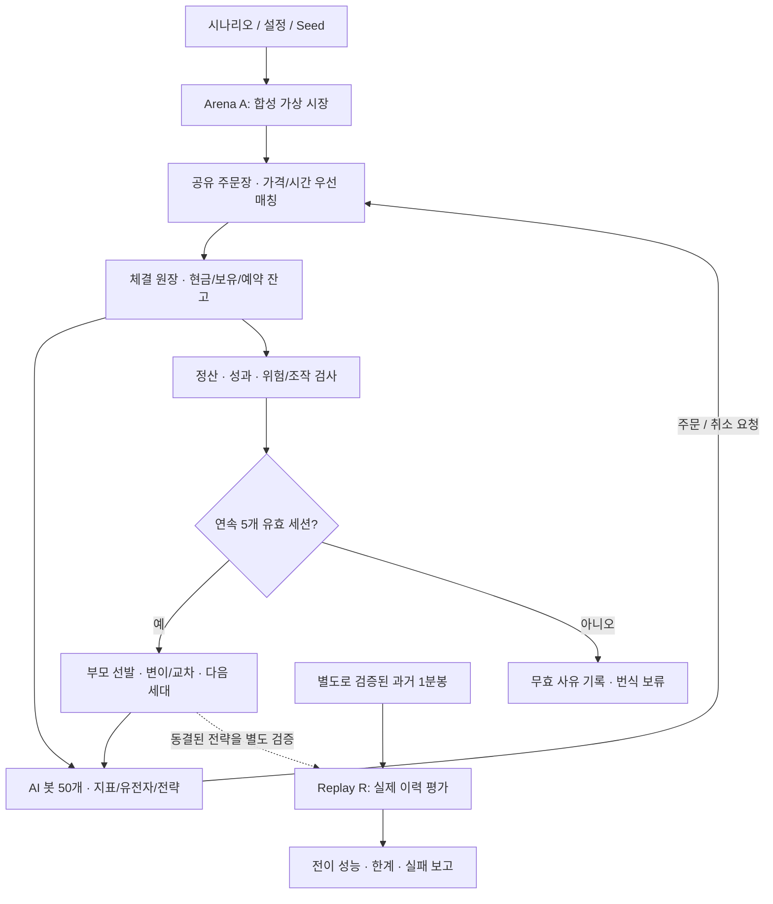
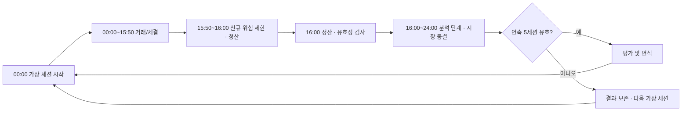

# V0.9 Virtual Market Arena

**공유 가상 시장에서 50개 AI 봇이 서로 경쟁하면서 진화하는 금융시장 시뮬레이션 연구 프로젝트.**

> **현재 상태 (2026-10-28): 설계 문서 준비 / V0.9 엔진 미구현 / 훈련·성과 검증 미실행**  
> 이 페이지는 길고 상세한 원본 설계서의 **읽기 쉬운 안내서**입니다. 가상 시장 결과는 실제 주식시장의 수익성을 의미하지 않습니다.

[**← 프로젝트 메인으로 돌아가기**](../../README.md)

---

## 1. 프로젝트를 한눈에 보면

| 항목 | V0.9 목표 |
|---|---|
| 연구 이름 | Virtual Market Arena |
| 출발점 | 기존 V0.8.2의 유전자·지표·진화 연구 |
| MVP 규모 | AI 봇 **50개**, 검증 후 100·250·500 순차 확장 |
| 거래 환경 | 봇들이 동일한 **중앙 지정가 주문장(LOB)**에서 경쟁 |
| 가상 세션 | **16시간 거래 + 최대 8시간 분석**의 논리적 사이클 |
| 진화 조건 | **연속 5개 유효 세션** 평가 후 부모 선택·번식 |
| 실행 위치 | 기존 주식 수집기와 분리된 홈서버 연구 환경 (구현 예정) |
| 실거래 주문 | **없음** — 토스 주문 API, 실제 계좌와 연결하지 않음 |

가장 중요한 변화는 **주문이 시장에 영향을 준다**는 점입니다. V0.8.x처럼 모든 봇이 외부에서 주어진 동일한 과거 가격만 보며 독립 매매하는 것이 아니라, 봇이 매수·매도 주문을 제출하면 주문장 잔량과 다른 봇의 체결 기회가 달라집니다.

## 2. 전체 구조

### 두 연구 트랙은 분리합니다

| 트랙 | 데이터 | 핵심 목적 | 현재 |
|---|---|---|---|
| **Arena A — 합성 가상 시장** | 합성 시나리오, 유한한 배경 유동성 | 주문 경쟁·가격 형성·진화 실험 | **설계만 완료** |
| **Replay R — 실제 과거시장 재생** | 검증된 과거 1분봉 | 가상 시장에서 선택된 전략의 외부시장 전이 평가 | **데이터 준비·엔진 미구현** |

**Arena A는 과거 1분봉을 충분히 확보하기 전에도 구현·단위 테스트를 시작할 수 있습니다.** 반면 Replay R에는 실제 이력의 범위, 시각, 결측, 거래일 검증이 필요합니다. 합성 주문장을 실제 시장의 호가·전체 체결 내역으로 소개하지 않습니다.

## 3. 가상 하루: 16시간 거래와 8시간 분석

**16시간과 8시간은 시뮬레이션상의 시간 구분**입니다. 실제 컴퓨터가 24시간을 기다려야 한다는 뜻이 아니며, 실제 미국 정규장(일반적으로 6시간 30분)과도 다릅니다. 분석 단계에서는 시장의 새 주문·체결을 발생시키지 않습니다.

## 4. 5세션 평가와 다음 세대

1. 각 봇의 **5개 연속 유효 가상 세션**을 평가합니다. 중간에 결측·미청산 등으로 세계가 무효가 되면 창을 유효 5세션으로 간주하지 않습니다.
2. **수익 부모가 존재하면** 수익 봇들을 후보로 삼아 기존 유전자 정책에 따라 교차·변이합니다.
3. **수익 부모가 없으면** 유효한 봇 중 순손익 → MDD → 적합도 → ID 기준으로 상위 2개를 **복구 부모**로 선택합니다. 후보가 1개면 단일 부모 변이, 유효한 후보가 0개면 번식을 중단합니다.
4. 자본 재설정, 체결 비용, 계보와 세대 변경 내역을 원장과 별도 산출물로 기록합니다.

> 수익이 없는 상위 2개는 **수익을 증명한 우수 전략**이 아니라 **복구를 위한 부모**입니다. 실현되지 않은 평가손익이나 조작된 마지막 가격으로 진화 성공을 판단하지 않습니다.

## 5. 지금 홈서버에서 어디까지 되었나?

| 구성요소 | 현재 확인된 상태 |
|---|---|
| 토스 OAuth 및 실시간 틱 수집 | **30종목 구독·CSV 파일 저장 확인** (2026-10-28) |
| 과거 1분봉 | **4종목 × 300행** 시험 저장, 장기·전체 거래일 검증 미완료 |
| 실시간/과거 자동 수집 스케줄러 | 서비스 구동·상태 확인, 장외 백필 장기 검증은 남음 |
| V0.9 Arena 매칭 엔진 | **미구현** |
| V0.9 AI 봇·진화 엔진 연결 | **미구현** |
| V0.9 Replay 평가 | **미구현** |
| 2026 Final OOS | **CLOSED** — 기존 연구 검증 게이트 유지 |

데이터 수집과 V0.9 실험은 서로 다른 시스템입니다. 실시간 주식 데이터가 모이고 있다는 사실만으로 V0.9 시뮬레이터가 실행되고 있는 것은 아닙니다.

## 6. 앞으로 개발할 순서

| 단계 | 핵심 산출물 | 완료 판단 |
|---|---|---|
| **M0** | 홈서버 자원·데이터 권한·시뮬레이션 규칙 확정 | 설정·검증 게이트 정의 |
| **M1** | 단일 주문장·정수 원장·예약 잔고·부분체결 | 자금/주식 보존·주문 우선순위 테스트 통과 |
| **M2** | 가상 시계·지연·유한 시장조성자·장 종료·복구 | 동일 시드 재실행 및 중단 복구 일치 |
| **M3** | V0.8.2 유전자 정책 연결, 50봇·5세션 진화 | 계보·진화 예외 케이스 검증 |
| **M4** | Replay R 및 독립된 시장 전이 평가 | 미래 데이터 차단·실패 결과까지 공개 |
| **M5** | 100/250/500개체 성능 측정, 대시보드 | CPU·메모리·저장량 측정 후 승인 |

M0~M5는 **원본 문서의 계획**으로, 구현이 완료됐다는 의미가 아닙니다. 특히 공동 주문장에서 자본을 부풀리거나 무한 유동성으로 가짜 수익을 만드는 오류를 막는 테스트가 우선입니다.

## 7. 자세히 읽기

| 문서 | 무엇을 확인할 때 읽나? |
|---|---|
| [**V0.9 종합 기획서**](V09_PROJECT_PROPOSAL.md) | 프로젝트 목적, 기능 목록, 예상 공수, 연구 범위, 위험 |
| [**V0.9 기술·검증 설계서**](V09_TECHNICAL_DESIGN.md) | 시스템 아키텍처, 주문장, 원장·자본, 유전자, 검증 기준 |
| [**독립·교차 검토 보고서**](V09_AGENT_REVIEWS.md) | 퀀트/아키텍트/레드팀 이견, 수정 사항, 최종 구현 차단 사유 |

### 문서 이력 및 구분

- **원본 출처:** `strategy-engine-v3/docs/v09/`, 2026-10-17 기획 합본
- **메인 브랜치 정리:** 2026-10-28. 원본 3개 파일은 내용 변경 없이 복사하여 양쪽 브랜치에 보존
- **현재 안내서:** 별도 새로 작성한 요약. 상세 요구사항 또는 계약에 충돌이 있다면 **원본 기술·검증 설계서 및 최종 검토 결과**를 우선
- **보안:** 실제 주문·실계좌·OAuth 토큰 발급 코드가 V0.9 엔진의 종속성에 포함되어서는 안 됨

---

[**메인 README로 돌아가기**](../../README.md)
