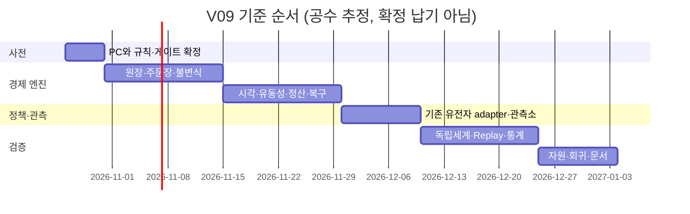

# V0.9 Virtual Market Arena — 종합 기획서

> 기획·설계 문서 합본 · 2026-10-17 · 코드 조사 기준 `24313f4874445fc4749ed8d5fcb9ffd5e04f0ea6`
> **연구 전용 / 구현·학습 미실행 / 2026 Final OOS CLOSED / Notion 미게시**

이 파일은 기존 모듈형 문서를 3개 공개용 합본으로 묶은 자료입니다. 원문의 모듈 경로는 출처 표기이며, 문서 간 링크는 이 합본 3개 안에서 연결됩니다. 다른 에이전트는 사실·설계 제안·미검증 상태를 구분하고 운영 코드나 데이터를 변경하지 않아야 합니다.

## 함께 읽을 문서

- [V0.9 Virtual Market Arena — 종합 기획서](V09_PROJECT_PROPOSAL.md)
- [V0.9 Virtual Market Arena — 기술·검증 설계서](V09_TECHNICAL_DESIGN.md)
- [V0.9 Virtual Market Arena — 독립·교차 검토 보고서](V09_AGENT_REVIEWS.md)

## 이 파일의 목차

- [V0.9 — Virtual Market Arena](#source-readme-md)
- [정식 프로젝트 기획서 — V0.9 Virtual Market Arena](#source-01-prd-md)
- [선행 연구·비교 대상·일차 자료](#source-02-related-work-md)
- [개발 로드맵·현실성·비용](#source-08-roadmap-md)
- [리스크·ADR·미해결 질문 등록부](#source-09-risks-adrs-md)
- [기획 작업·검증 기록](#source-10-progress-md)
- [최종 검수 — 설계 납품 / 게시·구현 게이트](#source-11-final-review-md)
- [Notion 게시 명세·권한 상태](#source-notion-publication-md)

---

*원문 모듈: `README.md`*

## V0.9 — Virtual Market Arena

> **진화하는 전략이 하나의 제한된 가상시장 안에서 경쟁할 때 무엇을 배우는가?**
>
> 실제 수익을 약속하는 자동매매 제품이 아니라, 전략·유동성·가격 형성의 상호작용을 반증 가능한 실험으로 검증하는 연구 플랫폼 제안서다.

| 문서 속성 | 내용 |
|---|---|
| 작성·출처 확인일 | 2026-10-17 |
| 기준 저장소·브랜치 | heh-heh/market-career-dashboard · strategy-engine-v3 |
| 코드 조사 기준 | `24313f4` 전체 SHA는 [코드 근거](V09_TECHNICAL_DESIGN.md#source-00-existing-system-md) 참조 |
| 출발점 | V0.8.2 Indicator-Aware Trading Intelligence |
| 개발 착수 목표 | 2026-10-26, 사전 게이트 충족 시에만 |
| 실행 배치 | 개인 PC 연구 엔진 / AWS 기존 경량 서비스 보존 |
| 지금 수행한 작업 | 문서·설계·독립 검토. 엔진 구현·훈련·운영 배포 없음 |
| 판정 | **설계 초안 검토 가능 / 구현·학습 착수는 조건부 차단** |
| 수익성 | 미입증. 가상시장 승자가 실제 시장 승자라는 주장은 금지 |
| 2026 Final OOS | **CLOSED** |
| Notion | 사용자 지정 상위 페이지 확인, 연결·작성 권한 미확보로 **미게시** |

### Executive Summary

기존 V0.8.2는 실제 Toss 완료 1분봉을 여러 독립적인 $100 계좌에 제공하고,
선형 유전자 정책을 5개의 연속 유효 거래일마다 진화시킨다. 그러나 한 봇의
매수가 다른 봇의 체결 기회나 시장 가격을 바꾸지 않는다. 이 모델은 인과적인
역사 연구에는 유용하지만, 제한된 유동성 경쟁·대기열·부분체결·자기 시장충격을
배우는 환경을 제공하지 않는다.

V0.9는 이 차이를 연구한다. 모든 봇이 공유하는 중앙 지정가 주문장, 명시적인
유한 자본의 외부 유동성 공급자, 관측 지연과 주문 도착 순서, 완전한 현금·주식
원장을 설계한다. 가상 16시간 거래와 최대 8시간 분석을 하나의 논리적 사이클로
정의하되 실제 미국 정규장과 동일시하지 않는다. 5회 유효 세션은 번식 시점이며
통계적 수익성의 증명 단위가 아니다.

핵심 선택은 **경쟁용 합성·내생 가격 Arena와 실제 데이터 리플레이 평가를 분리**하는
것이다. Arena에서는 체결이 가격을 형성한다. 최초 A는 합성 시나리오로 제한한다. 추후 H adapter를 별도 승인하면 실제 가격은
과거까지 관측된 맥락에만 사용하며 매칭 결과를 과거 종가로 되돌리지 않는다. 별도 Replay
트랙은 실제 완료 분봉과 보수적 체결 대용 모델로 전략 전이를 평가한다. 1분봉에서
실제 호가 대기열이나 완전한 체결 테이프를 복원했다는 주장을 하지 않는다.

독창성은 진화 알고리즘이나 주문장의 발명에 있지 않다. 기존 유전자·데이터 감사·
원금 보존 번식·관측소를 연결하고, **경쟁 → 외부 환경 → 실제 역사 리플레이** 사이의
전이 실패를 공개적으로 측정하는 연구 절차가 차별화 가설이다. ABIDES 등 기존
도구 대비 우월성은 아직 입증되지 않았다.

### 독자별 읽기 경로

- 심사·투자 검토: [기획서](V09_PROJECT_PROPOSAL.md#source-01-prd-md) → [비용·로드맵](V09_PROJECT_PROPOSAL.md#source-08-roadmap-md) → [리스크](V09_PROJECT_PROPOSAL.md#source-09-risks-adrs-md).
- 아키텍트·개발자: [현행 코드 근거](V09_TECHNICAL_DESIGN.md#source-00-existing-system-md) → [아키텍처](V09_TECHNICAL_DESIGN.md#source-03-architecture-md) → [시장 규칙](V09_TECHNICAL_DESIGN.md#source-05-market-simulation-md).
- 퀀트: [시장 규칙](V09_TECHNICAL_DESIGN.md#source-05-market-simulation-md) → [봇·진화](V09_TECHNICAL_DESIGN.md#source-04-bots-evolution-md) → [검증 계획](V09_TECHNICAL_DESIGN.md#source-06-validation-md).
- 검수자: [검토 기록](V09_AGENT_REVIEWS.md#source-07-reviews-md) → [최종 검수](V09_PROJECT_PROPOSAL.md#source-11-final-review-md).

### Notion으로 옮길 위키 구조

| 권장 하위 페이지 | 완성 문서 |
|---|---|
| 00 프로젝트 소개 | 이 README 및 [현행 코드](V09_TECHNICAL_DESIGN.md#source-00-existing-system-md) |
| 01 프로젝트 기획서 | [PRD](V09_PROJECT_PROPOSAL.md#source-01-prd-md) |
| 02 연구 및 선행 사례 | [선행 연구·출처](V09_PROJECT_PROPOSAL.md#source-02-related-work-md) |
| 03 시스템 아키텍처 | [설계·인터페이스](V09_TECHNICAL_DESIGN.md#source-03-architecture-md) |
| 04 AI 봇 설계 | [유전자·번식](V09_TECHNICAL_DESIGN.md#source-04-bots-evolution-md) |
| 05 시장 시뮬레이션 | [금융시장 모델](V09_TECHNICAL_DESIGN.md#source-05-market-simulation-md) |
| 06 연구 및 검증 | [가설·통계·전이 검증](V09_TECHNICAL_DESIGN.md#source-06-validation-md) |
| 07 에이전트 검토 기록 | [독립·교차·수정·최종 검토](V09_AGENT_REVIEWS.md#source-07-reviews-md) |
| 08 개발 로드맵 | [일정·비용·게이트](V09_PROJECT_PROPOSAL.md#source-08-roadmap-md) |
| 09 리스크 및 의사결정 | [위험·ADR·열린 질문](V09_PROJECT_PROPOSAL.md#source-09-risks-adrs-md) |
| 10 개발 진행 기록 | [기획 변경 이력](V09_PROJECT_PROPOSAL.md#source-10-progress-md) |
| 검수·게시 관리 | [최종 검수](V09_PROJECT_PROPOSAL.md#source-11-final-review-md), [Notion 게시 명세](V09_PROJECT_PROPOSAL.md#source-notion-publication-md) |

모든 수치에는 ‘기존 문서 기록 / 이번 코드 확인 / 신규 설계값 / 미측정 가설’을
구분한다. 수익성과 PC 처리량은 이번 기획 작업에서 실험하지 않았다.

---

*원문 모듈: `01_prd.md`*

## 정식 프로젝트 기획서 — V0.9 Virtual Market Arena

### 문제·가설·가치

독립 역사 백테스트는 ‘내 주문이 다른 참가자의 기회를 소모한다’는 반사실적
상호작용을 관측하기 어렵다. 기존 V082의 공통 가격은 이를 평가하도록 설계되지
않았다. V09는 다자간 경쟁 환경이 전략의 행동·비용·다양성을 어떻게 바꾸는지
검증한다. **경쟁을 추가하면 실제 수익이 좋아진다**는 명제는 출발 가설이며
제품의 보장 사항이 아니다.

정량적 가치 제안은 세 가지다. (1) 독립 체결 모델과 유동성 경쟁 모델의 결과 차이를
동일 계보·seed·자본 조건으로 설명한다. (2) 가격조작·MM 보조금·대기열 선점처럼
시뮬레이터 자체의 허점을 수익과 분리한다. (3) 실제 역사 재검증에서 실패한 가상
챔피언도 결과에 보존한다. 이런 설명 가능성과 실패 공개가 연구 도구의 납품 가치다.

### 사용자와 활용 시나리오

| 사용자 | 작업 | 산출물·성공 조건 |
|---|---|---|
| 개인 연구자 | 50봇의 기존 정책을 같은 시나리오에서 비교 | 설정·seed·원장 해시가 고정된 재현 가능한 episode |
| 퀀트 | 유동성·지연 변경이 alpha와 비용을 분리하는지 검사 | 불확실성을 포함한 paired 실험·독립 전이 평가 |
| 아키텍트 | PC에서 100/250/500/1000 목표의 병목 확인 | 실측 events/sec·p95 decision·RSS·로그량, 미통과 규모 차단 |
| 심사·투자자 | 실제 차별점과 한계를 평가 | 구현 증거/가설/미검증 구분, 공개 실패·비용·일정 |
| 관전자 | 시장·봇·진화의 원인 확인 | 가상시장 전용 배지, 현재 자식과 평가 부모 구분 |

### 범위 계약

**이번 납품**은 문서·검토 기록·인터페이스·검증 계획이다. V09 실행 코드가 아니다.
이후 MVP에는 단일 거래소·소수 가상 종목·50봇·시장가/지정가/취소·부분체결·예약
잔고·유한 MM·관측 지연·정산·재현·읽기 전용 관측을 포함한다.

정식 V09에는 검증된 시나리오 adapter, 가격·수수료·지연 민감도, 동결 상대방 평가,
기존 유전자 adapter, 100~500 규모 실측, 독립 Replay 전이 보고서를 포함한다.
1000개 이상, 실제 복수 거래소 routing, 완전한 NBBO/queue 복원, neural/RL,
실계좌·자동배포·실시간 투자 권유·2026 반복 검증은 범위 밖이다.

시장조성·scalping은 먼저 외부 기준 actor/연구 태그로 다룬다. 분봉 데이터만 있는
환경에서 해당 계열의 실제 체결 edge를 검증됐다고 표시하지 않는다.

### 기능 요구사항과 완료 기준

| ID | 요구사항 | 검증 가능한 수락 기준 |
|---|---|---|
| FR01 | 공동 주문장 | A의 주문이 남은 공개 수량을 감소시켜 B의 잔여 체결이 달라지는 최소예제 |
| FR02 | 가격·시간 우선 | 정수 tick/lot, 동일 가격 FIFO, 취소·부분체결·중복 명령 시험 |
| FR03 | 계좌·위험 | 예약 현금·주식의 이중 사용 0, 보존 원장 오차0 최소통화단위 |
| FR04 | 공개 정보 정책 | 의사결정은 수신된 이벤트와 완료봉만 사용, 미래/latent 공격 테스트 실패0 |
| FR05 | 5유효세션 진화 | 무효/미정산 세션이 끼면 창 무효; 가짜0일·조용한 skip 금지 |
| FR06 | 번식 예외 | 수익1부모/여러부모/무수익2보존/유효0차단 재현 |
| FR07 | 비용·유동성 | 미체결/부분체결/갭·깊이 소진을 기록; 고정 spread 이중 청구0 |
| FR08 | 재현·복구 | 동일 입력의 event/ledger hash 동일; 중간 kill→resume 동일 최종 상태 |
| FR09 | 관측·다운로드 | 가상/실제/Replay 명확 표시; 산출물만 읽는 상태 API |
| FR10 | 독립 검증 | 다른 환경·동결 상대방·실제 Replay 성과를 별도 보고 |

### 비기능 요구사항

- 안전: broker/token/order endpoint를 dependency graph에 포함하지 않는 별도 패키지.
  쓰기 허용은 신규 PC run root뿐; 역사·기존 결과·AWS는 읽기 또는 미연결.
- 재현: 정수 계산·PRNG stream·전체 설정 hash·source commit·데이터 hash·실패 이력.
- 자원: 규모별 실측으로만 승인. 목표 CPU/RAM 상한은 PC 확인 후 운영자가 설정.
  기존75/65/3% 기준은 출발 가드이지 PC 성능의 증거가 아니다.
- 운영: 디스크 부족이면 새 episode 중단, source/기존 artifact 자동 삭제 금지.
- 관측: UI 지연이 exchange clock을 바꾸면 안 됨. 이벤트 시각과 wall time 분리.
- 투명성: 합성·실제·혼합 provenance와 검증 범위를 모든 report에 기록.

### 프로젝트 성공과 중단

1차 성공은 원장·체결·인과성·복구 불변식을 모두 통과한 50봇 최소시장이다.
2차 성공은 경쟁이 결과를 바꾸는 원인을 replay로 설명하는 연구 보고서다.
실제 시장 적응력은 별도 가설 검정이며, 성과가 나빠도 타당한 반증은 성공적인
연구 산출물이다. 반대로 simulator 익스플로잇만 반복되거나 기존 replay 대비
연구 가치가 없으면 확대를 중단한다. 낙관적 수익률을 납품 기준으로 삼지 않는다.

---

*원문 모듈: `02_related_work.md`*

## 선행 연구·비교 대상·일차 자료

확인일 **2026-10-17**. HTTP 도달, 제목/초록, 본문, 서지 메타데이터는 서로
다른 증거 수준이다. 아래 확인은 법규의 완전성·적용 가능성이나 각 도구의 성능을
재현했다는 뜻이 아니다.

### 유사 프로젝트 및 연구 비교

| 자료·기관·연도·URL | 목적·방법·장점 | 한계·V09와의 관계 | 이번 확인 수준 |
|---|---|---|---|
| ABIDES, Byrd/Hybinette/Balch, arXiv2019, https://arxiv.org/abs/1904.12066 | agent-based discrete-event exchange, pairwise latency와다양한agent | 이미존재하는유사구조. V09의‘최초멀티에이전트시장’주장금지; 가능한재사용후보 | Quant가제목·초록확인. 성능숫자재현안함 |
| ABIDES 공식repository, https://github.com/abides-sim/abides | 재현가능한실제구현을검토할출발점 | 라이선스·현버전호환·유지보수·벤치마크는도입전별도확인 | HTTP200·공식repo제목확인,이번기획에서설치/실행안함 |
| Bristol Stock Exchange(BSE), Dave Cliff, arXiv2018, https://arxiv.org/abs/1809.06027 | 작고투명한LOB·거래알고리즘교육·실험 | 미국시장전체규칙·고충실도규제모형아님; 작은원장/매칭reference후보 | Quant제목·초록확인 |
| BSE 공식repository, https://github.com/davecliff/BristolStockExchange | 최소중앙거래소의이해·검증가능성 | V09의관측소·기존계보·OOSguard는별도통합필요 | HTTP200·repo제목확인,라이선스도입검토미완료 |
| ABIDES-Gym, arXiv2021, https://arxiv.org/abs/2110.14771 | discrete-event simulator와Gym형학습환경연결 | MARL/RL interface참고; V09는현재linear genome이며RL필수아님 | HTTP200·정확한제목확인. 정책성능/최신버전미검증 |
| JAX-LOB, arXiv2023, https://arxiv.org/abs/2308.13289 | GPU가속LOB와대규모RL실험 | GPU없이는V09불가라는근거아님; 순차규칙·장치batch전략비교후보 | HTTP200·제목확인. 논문성능숫자·재현성검증안함 |
| Challet & Zhang, Elsevier Physica A,1997, https://doi.org/10.1016/S0378-4371(97)00419-6 | ‘Emergence of cooperation and organization in an evolutionary game’; 경쟁과집단적행동의선행문헌 | LOB현실성/실제주식수익의증명아님. evolutionarygame관점참고 | Crossref공식API의제목/DOI/발행1997-12확인. 본문효과주장인용안함 |
| LeBaron, Handbook of Computational Economics Ch24,Elsevier2006, https://doi.org/10.1016/S1574-0021(05)02024-1 | ‘Agent-based Computational Finance’; 인공금융시장연구의장기맥락 | ‘유전진화하면실수익’이라는근거가아님. 연구모형대안분류용 | Crossref제목/DOI/연도확인. 본문검토미완료 |

ABIDES/BSE를검토하지않고매칭엔진전체를새로써야한다고단정하지않는다.
M0에서 **작은자체kernel / 기존kernel adapter / 별도framework 채택**을비교한다.
판단기준은원장·인과성시험가능성,라이선스,dependency무게,복구가능성,기존유전자연결
공수다. 현재선정된것은**단일writer의검증가능한계약**이며특정패키지의도입확정이아니다.

### 차별화 가설과 대안

진화형거래,인공주식시장,agentcompetition,LOBsimulation은이미연구된영역이다.
V09의차별화후보는기존Toss데이터감사·V082유전자·계보/관측소와연결한
`A경쟁훈련 → 독립frozen세계 → R역사전이`검증이며, **입증된시장/기술적우위가아니다**.
그가치가없으면기존V082연구도구를유지하고A개발확대를중단할수있다.

대안은단순독립백테스트개선,기존ABIDES/BSE의실험설정만추가,quote실행품질연구집중이다.
A를만드는이유는가격/유동성상호작용이라는새질문일때만정당하다. 높은백테스트수익을
보이기위해더복잡한시뮬레이터를만드는것은목표가아니다.

### 미국시장·주문·정산의 일차자료

| ID·기관·연도 | URL | 검증한 내용·적용 한계 |
|---|---|---|
| S01 NYSE,상시갱신 | https://www.nyse.com/markets/hours-calendars | Quant가HTTP200본문확인. core09:30~16ET,venue별early/late/경매·휴일/조기폐장. 16h가정의정규장근거아님 |
| S02 SEC/OIEA Investor.gov,연도미확정 | https://www.investor.gov/introduction-investing/investing-basics/how-stock-markets-work/types-orders | 시장가의체결가격보장없음,limit/stop기본본문확인. 모든venue세부규칙인증아님 |
| S03 SEC/OIEA,2024 | https://www.investor.gov/introduction-investing/general-resources/news-alerts/alerts-bulletins/investor-bulletins/new-t1-settlement-cycle-what-investors-need-know-investor-bulletin | 2024-05-28T+1준수일본문확인. 2022~23을T+1로소급하면안됨 |
| S04 FINRA,상시갱신 | https://www.finra.org/investors/insights/understanding-settlement-cycles | 대부분증권의T+1설명본문확인,예외·cashaccount무제한재사용을추정하지않음 |
| S05 FINRA,상시갱신 | https://www.finra.org/investors/investing/investment-products/stocks/day-trading | 일중거래설명본문조회. 특정PDT금액/횟수의2026현재적용은여기서확정안함 |
| S06 FINRA Notice14-28,2014 | https://www.finra.org/rules-guidance/notices/14-28 | self-trades와Rule5210공지본문확인. 가상botID STP가실제법적beneficialownership준수라는근거아님 |
| S07 NasdaqTrader,상시갱신 | https://www.nasdaqtrader.com/Trader.aspx?id=PriceListTrading2 | 공식요금표제목/본문조회. tier별실적용수치미검증,합성1bps는이표의실요율이아님 |
| S08 NasdaqFIX,버전미확정 | https://www.nasdaqtrader.com/content/technicalsupport/specifications/TradingProducts/inet_fix_sb.pdf | PDF존재만HTTP200확인. priority·orderflags본문을검증하지않았으므로동등성근거로사용금지 |

시장규칙의현재성은문서고정시점에재확인해야한다. 거래소수수료·법규는변할수있고
Toss지원범위는공식Toss문서와별도대조해야한다. 이번제안은실계좌적용/법률자문이아니다.

### 실패·제외한 인용 후보

- Nasdaq TradingHours 추측URL은HTTP200이지만 ‘Page Not Available’이어서제외했다.
- SEC의추측T+2페이지는503,추측cashaccount페이지는404여서검증근거로쓰지않았다.
- `https://arxiv.org/abs/cond-mat/9708006`는직접확인결과‘Two-way traffic flow’라는
  **다른논문**이었다. evolutionarygame자료로인용하지않는다.
- Iowa State의추측marks.htm bibliography는404였다. 실제문헌확인으로표시하지않는다.

존재만확인한논문·코드의성과수치나우위를생성하지않았다. 문헌을목록에넣는것과
우리플랫폼에서재현하는것은다르다. 비용·구현결정은M0의license/adapter평가후확정한다.

---

*원문 모듈: `08_roadmap.md`*

## 개발 로드맵·현실성·비용

### 전제와 범위

개발 착수 목표는 **2026-10-26**이다. 개인 PC CPU/GPU/RAM/OS/디스크 사양은 미확인.
실제 작업 인력·주당 가용시간도 미확인이다. 아래 공수는 한 명의 숙련 개발자 기준
**설계 추정 범위**이며 견적·납기 약속이 아니다. 거래소 엔진·통계 검증 경험이 없으면
보수 시나리오를 넘을 수 있다.

| 단계 | 작업·선행 의존성 | 기준 공수 범위 | 완료 게이트 |
|---|---|---|---|
| M0 | 10/26 환경·PC·출처·정보권한·정산 spec 확정 | 2~4 인일 | 미해결 Critical의 담당·시험 확정, PC inventory |
| M1 | 원장·정수·예약·price-time·부분체결·STP 최소 fixture | 8~15 인일 | G0/G1, 실제 주문 연결0 |
| M2 | 관측지연·외부유한MM·종료청산·자본 이체·복구 | 8~15 인일 | G2/G4, 50봇 toy episode 재현 |
| M3 | V082 adapter·5세션 진화·현재/평가 관측소 | 5~10 인일 | 기존baseline불변, 브로커 의존0 |
| M4 | R 기준·다른세계frozen평가·통계 보고 | 6~12 인일 | G5/G6/G7, 실패 포함 보고 |
| M5 | 100/250/500 규모·성능·문서·배포패키지 검토 | 5~12 인일 | 측정 통과 규모만 공개 |

단순합은34~68인일, 리스크·재검증은 별도다. 일부 병렬 작업도 매칭 원장 의존성은
피할 수 없다. 다음 달력은 주5일 전일 투입이라는 **명시적 가정**으로만 변환한다.

- 낙관: 7~9주, 단일종목/단순MM MVP와 초기 비교까지. 강건한 실제시장 전이 입증 제외.
- 기준: 10~14주, 다종목·복구·관측·독립 평가 포함한 연구용 V09.
- 보수: 16~24주 이상, 데이터 권한/quote근거·현실성·저사양 병목·원장 결함 재설계 시.

1000개 이상, 실시간 외부 data 연동, neural/RL, 실계좌 승격은 위 일정 밖이다.

위 Gantt의 d는 도식용 경과일이며 표의 인일과 동일한 근무일 스케줄 계산이 아니다.
실제 착수 때 휴일·가용시간·scope로 calendar를 다시 산정한다.

### MVP / 정식 / 확장

- MVP: 소수 synthetic 종목,50봇,단일book writer,유한외부MM,시장가/지정가/취소,
  정수원장,지연,정산실패차단,seed/복구,읽기전용기본관측.
- 정식연구V09: 다종목,유전 adapter,5유효세션,동결대조군,100~500측정,
  외부세계·Replay비교와invalid분모,문서화된인터페이스.
- 확장: 검토Tick 기반미시구조보정,1000+규모,독립세계병렬,별도neuralpolicy,
  더현실적인venue/auction. 검증 가치를 입증한 뒤 별도예산.

### 운영비와 PC/AWS 역할

PC가 data read·event kernel·evolution·checkpoint·report를 담당한다.
AWS는 기존 collector/API/대시보드만 유지한다. 신규 Arena 부하를 EC2에 옮기지 않는다.
원격 관측이 필요하면 완료된 압축 요약만 기존 인증 경계에서 전달하는 별도 제안을
검토한다. PC root·credential을 웹에 노출하는 shell endpoint는 만들지 않는다.

비용 산식은 `전력(kW)×wall시간×지역요금 + 신규저장GB×단가 + 백업비 + 개발인일×인건비`
다. PC 전력과 전기요금·장비비를 모르므로 금액을 창작하지 않는다.
디스크는 `events/session×bytes/event×sessions×compression_ratio + checkpoint + index`
로 추정하고 압축률은 실측한다. 로그 전체를 무한히 남기는 대신 필수 경제 event와
bounded decision/debug를 분리한다. 원본 삭제가 아니라 새 run 중단으로 공간을 보호한다.

별도 서버는 PC 실측이 정해진 실험 예산을 지속적으로 못 맞추거나, 여러 독립 연구자가
동시에 격리된 세계를 실행해야 할 때 검토한다. 먼저 독립세계 batch와보관정책을
개선한다. ‘1000봇이면 서버 필수’ 또는 ‘PC면 충분’이라는 단정은 하지 않는다.

### 10/26 전 필수 확인

PC사양·가용시간, Notion권한, 정확한 cash/lot규칙과정산게이트 승인,
기존데이터 manifest와라이선스, quote자료부족경고, seed/통계계획,
개발자가재현가능한clean환경, 이전V082baseline의소스·설정·결과 경로 확보.
이 중Critical 경제·정보 계약이 미완료이면 UI부터만들고학습엔진을시작하지 않는다.

---

*원문 모듈: `09_risks_adrs.md`*

## 리스크·ADR·미해결 질문 등록부

상태 용어: `SPECIFIED`는 문서에서 해결안을 정의한 것이며 `VERIFIED`가 아니다.
`BLOCKED` 항목은 그 게이트의 실측·구현 증거가 없음을 뜻한다. 수익으로 면제하지 않는다.

### 위험 등록부

| ID·수준 | 위험 | 통제·반증 | 담당·기한 | 현재 상태 |
|---|---|---|---|---|
| C01 Critical | 현금·재고 생성/예약 이중 사용 | 정수원장·유한MM·누적fee·매event 보존 G0 | Architect, kernel 이전 명세/실험 이전 증명 | SPECIFIED / 구현차단 |
| C02 Critical | 미래 bar·latent·미수신 fill 정보 | ObservationView·양의지연·prefix sentinel G1 | Architect+Quant, 정책 연결 전 | SPECIFIED / 증거없음 |
| C03 Critical | 미청산 봇 reset·가짜종가 청산 | 정상book 청산만, cohort invalid·실패세계봉인 G2 | Quant, 진화 연결 전 | SPECIFIED / 증거없음 |
| C04 Critical | 자기체결·wash·mark pump로 부모 조작 | STP계좌·공통조상진단·독립세계·조작자대조 G4 | RedTeam, 성과 실험 전 | 일부진단설계 / 공격검증필수 |
| H01 High | 무한 외부 보조금·MM 손실을 alpha로 포장 | Treasury/Issuer/MM 통합원장·수익원분해 | Quant, 환경동결전 | SPECIFIED |
| H02 High | 16h/8h와실제US세션혼용 | syntheticclock별도·R캘린더·휴장/DST | Architect, adapter전 | 설계정정완료 / 회귀미실행 |
| H03 High | fractional/tick/즉시정산을 미국시장과 동일시 | syntheticlot규칙과실규칙분리·법규근거 | Quant, PRD동결전 | 범위제한명시 |
| H04 High | 작은 표본·동시봇 독립성 오인 | 세계단위 paired평가·CI·다중검정·실패분모 | Quant, efficacy실험전 | 검증계획정의 |
| H05 High | 개인PC수용량불명·로그폭증 | 하드웨어inventory·단계부하·boundedqueue·diskguard | Architect+운영자, 개발착수전 | **PC확인필요** |
| H06 High | 기존AWS/collector/실주문에 영향 | 별도PC패키지·쓰기allowlist·brokerimport금지 | 총괄, 코드착수전 | 이번작업무변경확인 |
| H07 High | 2025 반복선택·2026누출 | devlabel·sourceguard·승인없는Final실행금지 | Quant, 모든실험전 | 기존정책보존 |
| H08 High | quote/tick/조정주가근거부족 | provisional·H2평가불가·manifest검토 | 데이터담당, 실제전이주장전 | **EC2자료미확인** |
| H09 High | 가격형성모델에만맞는전략 | generator/OOD/crossplay/R전이분리 | RedTeam, 후보승격전 | 미검증 |
| M01 Medium | bot ID·청산순서 우대 | tie seed·ID permutation·청산순서민감도 | Architect, kernel검증중 | 계획정의 |
| M02 Medium | 유전다양성상실·계보담합 | entropy/N_eff/부모기여/상대방손익 | Quant, 진화실험중 | 정책변경은별도실험 |
| M03 Medium | code/data/checkpoint 버전 불일치 | 불변source/config/inputhash·resume동등성 | Architect, 복구검증중 | 신규구현필요 |
| M04 Medium | 라이선스·데이터재배포 | Toss이용조건·외부데이터권리확인,rawNotion게시금지 | 운영자, 공유전 | 확인필요 |
| L01 Low | Notion 미게시를 완료로 오인 | publish manifest·실제pageURL·권한확인 | 총괄, 게시전 | **NOTION_ACCESS_UNAVAILABLE** |

### ADR

| ID | 결정·이유 | 대안·거절 근거 | 영향·재검토 조건 |
|---|---|---|---|
| ADR01 | A synthetic공동LOB와R실제Replay분리 | 과거가격덮어쓰기 hybrid는 인과성·정합성 충돌 | H는별도ADR; A/R가치검증후만 |
| ADR02 | 단일writer·결정론eventqueue | book별동시수정은순서·회계race | independentworld병렬우선, 측정병목후재검토 |
| ADR03 | 16h/8h는가상clock·분석budget | wall16h강제실행/실제US16h동일시 거절 | 실제session/DST는Rnamespace |
| ADR04 | finiteMM/background/Treasury/Issuer | 무제한quotedepth·fill_at_anchor거절 | 외부보조금별도기록, 사전finitebudget |
| ADR05 | int tick/microlot/cash_atoms+누적fee | float금액·부분체결별독립rounding 거절 | fractional은가상규칙; 실venueadapter는별도 |
| ADR06 | 진화봇실청산완료만valid | lastmark/보수적추정청산만으로부모인정 거절 | MM재고는별도보고, 봇하나미청산이면세계무효 |
| ADR07 | 거래하지않을자유·무수익보존부모 | 강제매수/거래보상·무효0PnL거절 | 신규fitness는다른실험으로분리 |
| ADR08 | owner=가상경제계좌 STP | 인간연구자공통owner로전원매칭금지는목표소멸 | 실제beneficialownership준수주장없음; wash공격별도 |
| ADR09 | 실제장기성과·PC처리량미입증 | 기존합성4.54초를1000봇엔진근거로환산 거절 | 실제PC규모별profile와원시로그필요 |
| ADR10 | 2026CLOSED·실주문모듈의존0 | synthetic개발이란이유로OOS접근허용 거절 | 별도사용자승인없는최종실험없음 |
| ADR11 | 기존AGENTS/운영파일무변경·역할지침별도보관 | root agentinstructions덮어쓰기거절 | docs/agents에서만재사용지침관리 |
| ADR12 | Notion권한없으면Markdown동일계층완성 | publicURL만으로작성권한확보했다고주장 거절 | 연결후중복검색·parent확인·append-only게시 |

### 공개된 이견과 최종 처리

1. Architect R1은16h/8h를wall운영창으로 해석했다. Quant/RedTeam 반박 후 R2에서
   **가상clock+별도wall budget**으로 정정했다. 종전보고서는 수정없이보존하여경위를남긴다.
2. Quant R1은 hybrid를최종목표로권고했다. Architect/RedTeam은현실성이자동증가하지
   않는다고반대했다. 최종은 **A/R 우선, H는보류**. 합의되지않은 장기효용은열린가설이다.
3. Quant의beneficialowner/STP는실법률과arenaowner의혼동을일으켰다. 최종은가상계좌
   STP와cross-bot조작진단. 실제규제동등성은주장하지않는다.
4. 보수적청산추정치를부모PnL로쓰자는대안은거절했다. 실제가상book청산을요구한다.
   다만이선택은종료유동성에매우민감하므로평가실패율을숨기면안된다.
5. ‘모든참가자flat’은MM가초기주식을소유하는보존식과충돌한다. **진화참가봇만flat**,
   외부MM/backgroundinventory별도보고·carry로명확히한다. 아래round4의견을반영한다.

### 개발 전에 답할 열린 질문

- PC사양·주당가용시간·디스크·OS·백업위치와실측승인자는누구인가?
- 초기symbol수·scenario family·유한MM/Treasury의총예산은무엇인가? 무한값은허용하지않는다.
- MM0후보식의채택여부,quote가격/size/interval·재고한도·no-bid소진정책의고정값은무엇인가? 후보식은검증된기준이아니다.
- 공개orderbook depth와지연배포정책·익명성, actor별rate limit의공정기준은무엇인가?
- 실제Tick의사용권·LOSSY metadata·소스조정·시각근거가충분한가?
- 효과크기·risk ceiling·독립세계표본수는예산내에서어떻게사전등록할것인가?
- Notion연결에서사용자가지정한parent하위쓰기·검색권한이있는가?

숫자가미정인질문을임의의‘검증값’으로채우지않는다. M0에서범위와검증계획을승인한뒤에만
구현을착수한다. Critical 구현게이트가열린상태에서개발준비완료라고판정하지않는다.

---

*원문 모듈: `10_progress.md`*

## 기획 작업·검증 기록

### 2026-10-17 — 설계 납품 작업

1. 사용자 V09 지시서 전문을 읽고 구현/학습/AWS/실거래/운영배포 제외를 확인했다.
2. clean `strategy-engine-v3`에서 원격을 fetch하여 `c50524d`에서 최신 `24313f4`로
   fast-forward했다. 원격에 이미 추가된 V082 봇 관측소를 새로 구현했다고 주장하지 않는다.
3. V07~V082 실제 genome/fitness/feature/data/계좌/번식/자원/관측소를 조사했다.
4. 실제 sub-agent3개가 독립 R1을 작성하고 R2 교차 검토, 총괄 R3 수정, R4 재검토를 했다.
5. 공식 금융문서와 실제 논문·repo의 접근 수준을 구분했다. 잘못된 arXiv 링크와404자료를
   관련 연구로 인용하지 않았다.
6. 사용자가 Notion parent URL을 제공했다. 도구·credential binding 부재로 게시하지 않았다.
7. 문서·출처·8개 Mermaid 다이어그램·위험·ADR·검수·게시 계약을 작성했다.

### 이번에 하지 않은 것

- 거래/매칭/진화 엔진 구현, 새 학습·백테스트·벤치마크 실행.
- 원본 CSV/Tick/기존 결과·설정·credential 수정, EC2 접속·배포·서비스 재시작.
- GitHub main 변경, 공개 Pages 갱신, 실주문·ARM 변경.
- Notion 쓰기 성공 주장, 실제 PC 처리량/수익성 입증 주장.

### 이후 실험 기록 템플릿

각 항목은 미실행 상태이며 가상 성과로 채우지 않는다.

| 필드 | 기록 내용 |
|---|---|
| experiment_id / hypothesis | 사전등록 가설·주 지표 |
| code/config/data/scenario hash | 재현 식별자 |
| frozen policy/opponents/seeds | 비교군과 환경 경계 |
| periods / provenance | train22~23 / internal24 / dev25 / 2026CLOSED |
| resultsValid / invalidReasons | 실패와 분모 포함 |
| accounting/causality/recovery gates | 예정 / 실행 / 통과 / 실패 및 증거 |
| measured resources | PC 사양과 원시측정 파일 링크 |
| comparison / uncertainty | paired효과·CI·risk·집중도 |
| decision | KEEP_BASELINE / INCONCLUSIVE / REJECT / RESEARCH_CANDIDATE |

기획서 수정과 실험의 결과 수정은 다른 변경 이력이다. 실험 실패를 숨기기 위해
기존 artifact를 덮어쓰거나 유리한 기간만 남기지 않는다.

---

*원문 모듈: `11_final_review.md`*

## 최종 검수 — 설계 납품 / 게시·구현 게이트

**최종 판정: 기획·설계 문서는 검토 가능. IMPLEMENTATION_NOT_READY / EXECUTION_BLOCKED.**
Notion은 **BLOCKED_NOTION_CONNECTION_REQUIRED**, 실제 생성된 하위 페이지 URL은 없다.

Critical 위험의 해결 방향이 문서화됐어도 원장·시각·청산·정보 불변식의 구현 증거는
없다. 이것을 ‘Critical 해결 완료, 개발 준비 완료’라고 표현하지 않는다.
Notion에 게시할 준비와 금융 시뮬레이션을 실행할 준비도 별도다.

| 필수 항목 | 상태·근거 |
|---|---|
| 실제 코드 분석 | 완료: [00](V09_TECHNICAL_DESIGN.md#source-00-existing-system-md), 코드 기준24313f4. EC2 배포상태/실데이터검사 제외 |
| 전문가3개 독립 검토 | 완료: [Round1·역할 원문](V09_AGENT_REVIEWS.md#source-07-reviews-md). 외부인간인증 아님 |
| 상호반박·수정·재검토 | 완료: [Round2/3/4 ledger](V09_AGENT_REVIEWS.md#source-07-reviews-md), 이견 보존 |
| Critical 처리 | 통제 spec 정의, 구현증거 미확보로 차단: [C01~C04](V09_PROJECT_PROPOSAL.md#source-09-risks-adrs-md) |
| 구현 가능성·비용 | 조건부: [아키텍처](V09_TECHNICAL_DESIGN.md#source-03-architecture-md), [공수·PC 미확인](V09_PROJECT_PROPOSAL.md#source-08-roadmap-md) |
| 가격 형성 | 정의: [A/R/H 대안·유한MM](V09_TECHNICAL_DESIGN.md#source-05-market-simulation-md). 실제시장 동등성 미입증 |
| 실제시장 적응력 | 계획 정의: [독립 세계·R 전이](V09_TECHNICAL_DESIGN.md#source-06-validation-md), 결과 없음 |
| 번식 예외 | 정의: [수익·보존·단일·무효](V09_TECHNICAL_DESIGN.md#source-04-bots-evolution-md), 다중봇99invalid 제외 금지 |
| CPU/RAM 검증 | 계획만: [규모별 측정](V09_TECHNICAL_DESIGN.md#source-03-architecture-md), 사양/처리량 UNKNOWN |
| MVP/확장 | 정의: [PRD](V09_PROJECT_PROPOSAL.md#source-01-prd-md), [로드맵](V09_PROJECT_PROPOSAL.md#source-08-roadmap-md) |
| 일차 출처 | 접근수준·연도·확인일: [02](V09_PROJECT_PROPOSAL.md#source-02-related-work-md), 실패출처 제외 |
| 다이어그램 | 아래8종 본문 Mermaid, 렌더링은 대상Notion에서 추가확인 필요 |
| 우선순위·완료조건 | [Gate G0~G7](V09_TECHNICAL_DESIGN.md#source-06-validation-md), [M0~M5](V09_PROJECT_PROPOSAL.md#source-08-roadmap-md) |
| Notion 계층·URL 검증 | **미완료**: [권한·게시 명세](V09_PROJECT_PROPOSAL.md#source-notion-publication-md), parent는사용자지정URL |
| 과장된 수익성 주장 | 미입증 명시. 5세션·bot수·synthetic승자는수익성증거아님 |

### 필수 시각자료 위치

1. 전체 아키텍처: [03](V09_TECHNICAL_DESIGN.md#source-03-architecture-md)
2. 가상 24h 사이클: [05](V09_TECHNICAL_DESIGN.md#source-05-market-simulation-md)
3. 주문·체결 흐름: [05](V09_TECHNICAL_DESIGN.md#source-05-market-simulation-md)
4. 유전자·판단 구조: [04](V09_TECHNICAL_DESIGN.md#source-04-bots-evolution-md)
5. 봇 경쟁·상호작용: [12](V09_TECHNICAL_DESIGN.md#source-12-dashboard-md)
6. 5세션 평가·진화: [04](V09_TECHNICAL_DESIGN.md#source-04-bots-evolution-md)
7. 데이터 검증 파이프라인: [06](V09_TECHNICAL_DESIGN.md#source-06-validation-md)
8. 개발 로드맵: [08](V09_PROJECT_PROPOSAL.md#source-08-roadmap-md)

### 납품 경계와 다음 행동

지금 납품은 동일계층Markdown·세전문agent의원문·통합설계·검수·manifest다.
운영코드변경이나실험을하지않아Python/JS전체CI를재실행할이유가없다.
문서파일·링크·개수·코드원본해시·출처수준은별도문서검증기록으로검사한다.

다음은Notion연결·쓰기권한과PCinventory, M0의유한MM/Treasury/rate/latency수치고정이다.
그후G0~G2 불변식부터구현하며,미확인성능을근거로1000봇을시작하지않는다.
2026 Final OOS와실거래승격은이계획의자동단계가아니다.

---

*원문 모듈: `notion_publication.md`*

## Notion 게시 명세·권한 상태

### 사용자 지정 대상

상위 페이지: https://app.notion.com/p/sungwon910/3fc32f2ae7a6805288e8f253fc9cb944

이 URL은 사용자가 게시 대상으로 제공했다. **검색·읽기·쓰기 권한이 API로 확인된
페이지가 아니며, 이번 작업에서 생성한 URL도 아니다.**

현재 세션에는Notion MCP/App 도구가없고Notion credential binding도확인되지않았다.
따라서실제하위페이지를생성·수정하거나기존문서와중복여부를검색하지못했다.
게시상태는`BLOCKED_NOTION_CONNECTION_REQUIRED`다. Markdown완성과게시완료를구분한다.
비밀token은채팅·문서·repository에요청하거나저장하지않는다.

### 연결 이후 게시 절차

1. 사용자가Notion앱/통합을연결하고위parent의검색·하위페이지생성권한을공유한다.
2. parent 실제제목·workspace·권한을조회하여URL의의도와일치하는지확인한다.
3. parent하위에서`V0.9 — Virtual Market Arena`를검색한다. 기존동일프로젝트가있으면
   중복root를생성하지않고기존소유페이지와수정범위를확인한다.
4. README의00~10계층에문서를매핑한다. reviews의Round1/2/4는원문하위페이지로보존한다.
5. 로컬상대링크를실제Notion page URL로치환하고표·Mermaid codeblock을전송한다.
   Mermaid렌더지원여부는실제로확인하고미지원이면코드블록+별도그림산출물로표시한다.
6. risk/ADR/issue/validation을가능하면DB로생성한다. 기존DB가있으면schema를조회한뒤
   필드매핑하고기존행을덮어쓰지않는다.
7. 게시manifest에local파일SHA256、NotionpageID/URL、parentID、revision/updatedAt、
   연결검증상태를기록한다. 금융·성능검증상태와별도다.
8. 모든링크와문서수·리뷰원문·상태배지·2026CLOSED를읽기API로역검증한다.

### 제안 DB 속성

- Risk: ID, 심각도, 근거, 담당, 선행gate, 상태, 반증test, 최종검토일.
- ADR: ID, 결정, 대안, 이유, 영향, 재검토조건, 관련risk.
- Validation: Gate, 검증방법, 예정/실행/통과/실패, evidenceURL, 코드commit.
- Review: Round, reviewer, 문서, 주장, 반박, 처리상태, 남은이견.

게시하지않은상태에서는`publication_manifest.json`의pages목록을빈배열로유지한다.
사용자상위URL을생성완료pageURL로채우지않는다. 기존Notion자료·EC2원본을삭제하지않는다.
