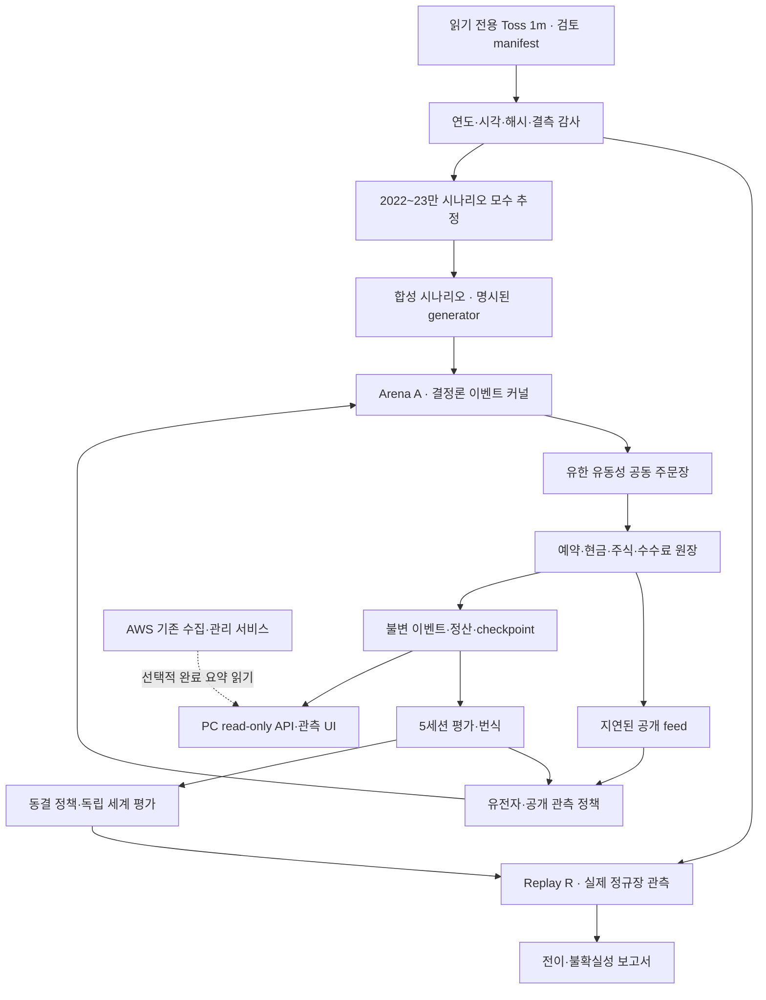
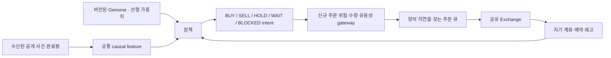
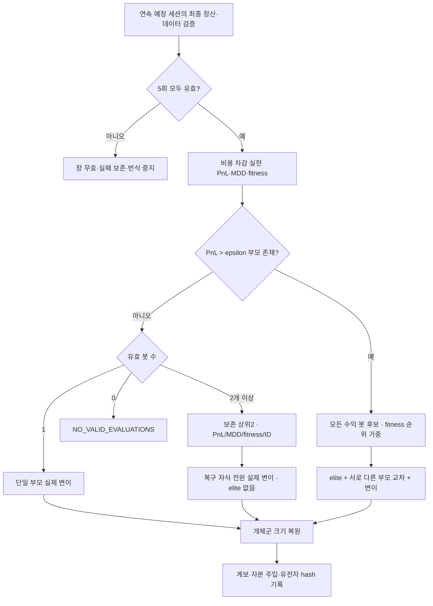
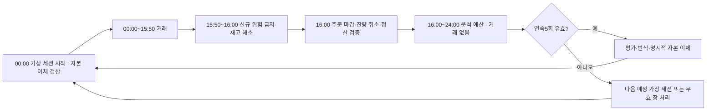
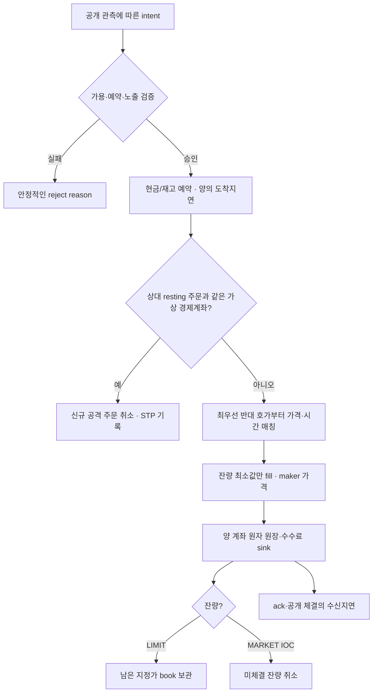
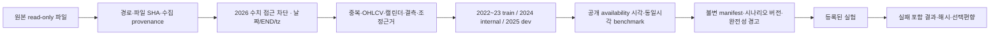
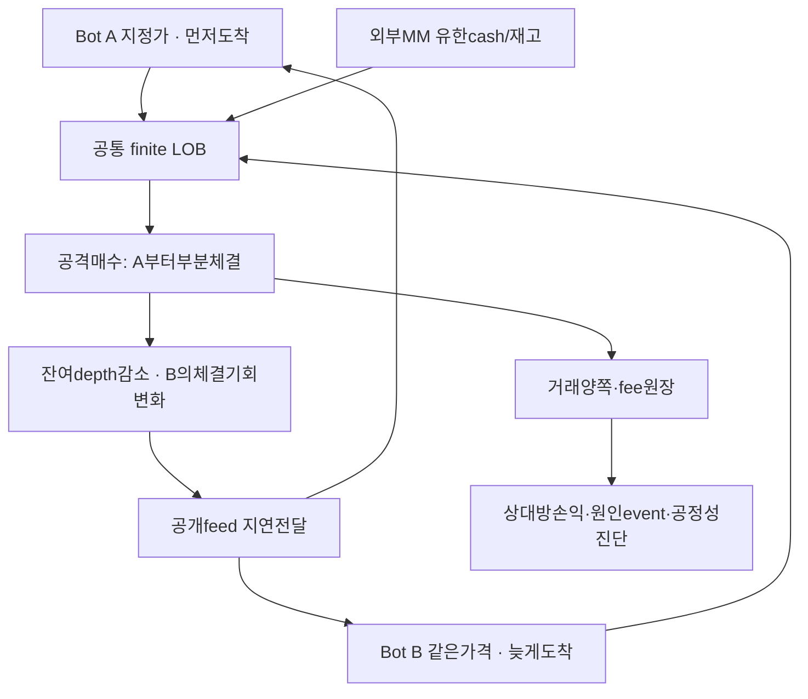

# V0.9 Virtual Market Arena — 기술·검증 설계서

> 기획·설계 문서 합본 · 2026-10-17 · 코드 조사 기준 `24313f4874445fc4749ed8d5fcb9ffd5e04f0ea6`
> **연구 전용 / 구현·학습 미실행 / 2026 Final OOS CLOSED / Notion 미게시**

이 파일은 기존 모듈형 문서를 3개 공개용 합본으로 묶은 자료입니다. 원문의 모듈 경로는 출처 표기이며, 문서 간 링크는 이 합본 3개 안에서 연결됩니다. 다른 에이전트는 사실·설계 제안·미검증 상태를 구분하고 운영 코드나 데이터를 변경하지 않아야 합니다.

## 함께 읽을 문서

- [V0.9 Virtual Market Arena — 종합 기획서](V09_PROJECT_PROPOSAL.md)
- [V0.9 Virtual Market Arena — 기술·검증 설계서](V09_TECHNICAL_DESIGN.md)
- [V0.9 Virtual Market Arena — 독립·교차 검토 보고서](V09_AGENT_REVIEWS.md)

## 이 파일의 목차

- [현행 시스템 조사와 재사용 판단](#source-00-existing-system-md)
- [시스템 아키텍처 및 기술 계약](#source-03-architecture-md)
- [AI 봇 유전자·위험·진화 명세](#source-04-bots-evolution-md)
- [가상시장·주문·가격 형성 설계서](#source-05-market-simulation-md)
- [실험·통계·반증 및 데이터 검증 계획](#source-06-validation-md)
- [관전·분석 대시보드와 읽기 모델](#source-12-dashboard-md)


---


<a id="source-00-existing-system-md"></a>

*원문 모듈: `00_existing_system.md`*

## 현행 시스템 조사와 재사용 판단

조사일 2026-10-17. 조사 대상은 실제 GitHub 브랜치를 fetch한 뒤 fast-forward한
`strategy-engine-v3`의 `24313f4874445fc4749ed8d5fcb9ffd5e04f0ea6`다. 운영 EC2와 연구 디스크는 접속하지 않았다.
운영 배포 여부, 실제 장기 학습 성과 및 Tick 품질은 **확인되지 않음**이다.

### 코드 기준 흐름

`Toss 수집 원본(읽기 전용)` → `data_access/available_data의 기간·해시·캘린더 감사`
→ `run_v07_available의 날짜 순 공유 적재` → `MinuteFeatureProvider`
→ `IndicatorCache` → `유전자별 점수` → `계좌별 allocation`
→ `다음 완료 분봉 종가 대용 체결` → `5일 유효성·fitness`
→ `V081 survival reproduction` → `고유 결과 디렉터리` → `V082 관리·봇 관측소`.

V0.9가 추가하려는 공동 주문장, 외부 MM, 참가자 간 영향은 이 흐름에 없다.

| 대상·확인 위치 | 실제 확인된 기능 | 재사용 / 수정 / 신규 및 근거 |
|---|---|---|
| `research/evolution/genome.py` Genome/random_genome/crossover/mutate | 불변 유전자, 기존 정책 가중치·선택적 맥락·15개 지표 가중치, JSON/hash, bounded mutation | 표현·직렬화 **재사용**. 주문 성향·유동성 민감도는 별도 V09 스키마. 기존 파일 덮어쓰기 금지 |
| `population.py` aggregate_window_evaluations/reproduce | 계좌별 평가, 유효한 연속 5일 묶음, 부모/자식 기록 | 순서·유효성 틀 **재사용**. 다자간 원장·MM 손익은 **신규** |
| `survival_breeding.py` valid_window/parent_candidates | 유효 5일 순손익>epsilon 전원 후보, 아니면 PnL 내림/MDD 오름/fitness 내림/ID 상위2 | 정책 **재사용**. 후보1개 단일 변이, 0개 중단. Arena 청산 검증을 부모 자격 앞에 **신규** 추가 |
| `profit_only.py` reproduce_profit_only | 수익 후보 사이 fitness 순위 가중, elite·상대 부모 교차 | **재사용**하되 재현 시험 후 adapter; 복구 자식 실제 변이 보장 유지 |
| `features.py` MinuteFeatureProvider | END 관측 시각, 정확한 벤치마크 조인, 공통 matrix, 결측 prefix 종료 | Replay에 **재사용**, Arena 공개 이벤트→완료봉 집계 adapter **신규** |
| `indicators.py` compute_indicators/IndicatorCache | SMA/EMA/VWAP/MACD/RSI/StochRSI/ADX/ATR/BB·거래량·변동성, 세션 공유 계산 | **재사용**. SMA200은 200분 warmup. 16h 환경·인벤토리 반영은 adapter 검증 필요 |
| `indicator_engine.py` Portfolio/allocation/evaluate_day | 봇별 계좌, 최대3종목, 현금/상관/손절 위험/유효 레버리지 제한 | 위험 개념 **재사용**, 예약잔고·미체결 주문 위험·공동청산 ledger **신규**. 현재 봇 간 가격 경쟁은 없음 |
| `account.py` ExecutionCostModel/Account | fractional long-only, 양방향 2+1bps 비용, 완료 종가 mark/체결, 거래 provenance | Replay 기준 **재사용**. LOB에서는 실제 가상 spread/가격 이동과 고정 spread 중복 청구하지 않도록 **새 cost adapter** |
| `engine.py` evaluate_day | indicator_aware 설정만 V082 evaluator에 dispatch | 기존 버전 **보존**. Arena는 별도 실행기·별도 namespace |
| `regime_timing.py` market_context/window_objective | 완료 SPY/QQQ 맥락, 비용 포함 순수익·MDD·과매매·일관성·타이밍 fitness | 진단 필드·비교 기준 **재사용**, 가격조작/대기열 공정성 테스트 **신규** |
| `data_access.py` check_dates/bounded_bars/scheduled_days | 2026 수치 접근 차단, END 의미, 날짜 순 스트리밍 | **그대로 유지**. 합성 시나리오도 훈련/평가 provenance 명시 |
| `available_data.py`, `run_v07_available.py` | 원본 해시 확인, 결측 cohort 무효, 새 output, 5일 checkpoint | **재사용**. 이벤트 큐·예약·RNG 상태까지 포함하는 복구 snapshot **신규** |
| `run_v07_campaign.py`, `v07_holdout_config.json` | 초기 V07 캠페인 및 기간별 frozen 연구 구조 | 기준 재현용 **보존**. 7일 모델을 새 5일/16h 모델로 덮어쓰지 않음 |
| `run_v081.py`, `calibrate_v081.py`, `adaptive_capacity.py` | 자원 sampling, 고정 개체군 반복 시험, CPU75/RAM65/Swap3, host/code/hash 증명 | 계측 방법 **재사용**. PC 사양과 Arena 처리량은 **신규 측정** |
| `run_v082.py`, `calibrate_v082.py`, V082 config | 50개체 고정, warmup+2회, 신규 인증, 자동 장기 학습 금지 | 비교군 **보존**. 100~1000 목표를 이 코드의 승인으로 해석하지 않음 |
| `v082_web_jobs.py`, `v082-web.js` | 인증 console, 별도 결과·상태, frozen24/25, 역사 지표/위험 카드 | 읽기 모델·UX **재사용**. Arena start/clock/LOB API는 **미구현** |
| `v082_bot_roster.py` snapshot / `bot-roster.js/.css` | `V082_BOTS_1`, 50개 상한, 제한 크기 artifact, 현재 자식과 평가 부모 분리 | 관측소 계약 **재사용 검토**. 1000개 pagination·이벤트 stream **신규**. 상한만 제거하면 안 됨 |
| `admin.html`, `server.py` bots console | 관리자→AI 봇 UI 및 인증 경로 | 화면 설계 참조만. 이번 작업에서 변경·서비스 재시작 없음 |

### 버전별 해석

- V07 기존 fitness/7일 및 별도 strict5일 실험이 공존한다. ‘V07=항상5일’로 단순화하지 않는다.
- V08은 수익 부모만, 무수익 random recovery를 갖는다. V081은 무수익 원금 보존 부모를 도입한다.
- V082는 V081 번식 + 공유 지표 + 50개체·다중 포지션 평가다. 실제 신경망/RL 모델이 아니다.
- 관측소의 실제 UI/코드는 확인했다. 운영 서버에 최신 코드가 설치됐다는 증거는 없다.

### 자원·처리량 증거의 한계

`V082_INDICATOR.md`는 이전 개발 작업의 합성 50개체×5일 1세대 ~4.54초,
RSS ~89.25MiB, 샘플 host CPU 최대41.6%를 기록한다. 작은 1세션 비교에서
V081100 ~0.388 CPU초, V08150 ~0.313, V08250 ~0.602였다는 기록도 있다.
이는 **문서에 남은 이전 합성 기록**이며 이번 기획에서 재실행하지 않았다.
Codex 환경의 값이고 개인 PC/EC2 성능·1000개체 확장·수익성을 입증하지 않는다.
원시 당시 측정 파일이 배포 산출물로 모두 제공되는지 확인되지 않아 투자·성능
주장의 근거로 사용하지 않는다. V09의 events/sec는 아직 **미측정**이다.

### 실제 데이터 확인 범위

소스 코드의 파일 reader/guard는 확인했지만 EC2의 2022~2025 전체 CSV, 조정주가
근거, 최종 manifest, Tick 누락률은 이 세션에 없다. 완료 1분봉은 호가 깊이·
대기열·주문 취소·정확한 spread를 제공하지 않는다. Tick 수집도 LOSSY이면
완전한 exchange tape가 아니다. V09는 자료 부족을 합성 태그로 드러내야 한다.

코드 링크 기준: https://github.com/heh-heh/market-career-dashboard/tree/24313f4


---


<a id="source-03-architecture-md"></a>

*원문 모듈: `03_architecture.md`*

## 시스템 아키텍처 및 기술 계약

모든 구성요소는 **설계 제안 / 미구현**이다. 기존 코드는 [재사용 근거](V09_TECHNICAL_DESIGN.md#source-00-existing-system-md)를 참조한다.

### 분리된 두 연구 트랙



A는 가격·대기열의 상호작용을 연구한다. R은 외생적 관측을 고정하고 전이를 평가한다.
R에서는 ‘내 주문이 실제 과거 시장의 가격을 바꿨다’고 주장하지 않는다. R에 1분봉만
있으면 실제 depth·queue fill은 알 수 없다. A의 synthetic tick/LOB와 실제 Tick은
별도 provenance/schema로 관리한다. 최종 선택은 **단순 A sandbox와 R 기준을 우선 분리**하는 것이다. H 과거 맥락
adapter는 별도 ADR로 보류하며 A/R의 가치가 없으면 도입하지 않는다. 두 세계를
동일 가격 시계열인 것처럼 동기화하지 않는다.

### 이벤트 커널

한 exchange가 한 symbol book을 소유하는 단일 writer를 MVP 기준으로 정한다.
Python 단일 프로세스가 최초 기준이며, 속도가 확인되기 전 매칭을 병렬화하지 않는다.

`EventEnvelope` 제안:

| 필드 | 의미 |
|---|---|
| run_id / scenario_id / generation / episode | 세계·설정 식별, 누락이면 실행 차단 |
| event_id / global_sequence / causation_id | 동일 run 내 순서·원인; 실제 exchange sequence라는 의미 아님 |
| sim_event_ns / available_at_ns | 시뮬레이션 발생·수신 가능 시각 |
| source_timestamp / source_kind | 실제 입력의 원시 시각 또는 synthetic; 없는 source 시각을 창작하지 않음 |
| received_timestamp / wall_utc | 실제 파일·feed 수신 및 실행 관찰 시각, sim time과 분리 |
| symbol / actor_id / economic_account_id | 가상 계좌 소유권·동시대 참가자 |
| payload_schema / config_hash | 이벤트 버전·설정 증거 |

같은 시각의 커널 phase는 외부 입력 공개→도착 주문의 sequence 순 처리→체결·ack
예약→공개 feed 전달→봇 결정→양의 지연을 갖는 새 주문 예약으로 한다. **취소를
모든 시장가 주문보다 먼저 실행하는 별도 우대 phase를 만들지 않는다.** 같은 도착
시각 명령의 queue sequence가 우선이며, 생성 시 동률은 사전 고정한 seed 기반
순열로 결정한다. bot ID 순환·순열 대조로 특정 ID 우대를 검사한다.

봇은 `ObservationView(observed_at)`만 받는다. 커널의 미래 이벤트 heap, generator의
latent fundamental, 타 봇의 미공개 주문·현금·유전자에는 접근하지 못한다. 하나의
프로세스 내부 인터페이스는 연구용 정보 장벽이며 적대적 임의 Python 코드에 대한
보안 sandbox라고 주장하지 않는다.

### 인터페이스와 책임

| 컴포넌트 | 입력→출력 | 불변식 |
|---|---|---|
| ScenarioProvider | 검토된 과거 범위·seed→외부 사건 | 2026 수치 및 미래 시나리오 관측 누출0 |
| ObservationBuilder | 공개 수신 사건→quote/trade/완료봉 | bar observable 시각 이전 feature 제공0 |
| PolicyAdapter | 공개 feature·자기 계좌·genome→intent | 다른 참가자의 private state 참조0 |
| RiskGateway | intent·예약/포지션→승인/거절 | 동시 주문 합산 cash/inventory/risk cap |
| Exchange | 승인된 주문 도착→fill/cancel/reject | price-time, partial fill, STP, 수량 보존 |
| ClearingLedger | fill→원장 entries | 금전·재고 보존·원자적 양 계정 기록 |
| Evaluator | 최종 정산 episode→validity/fitness | invalid은 손익0·부모로 변환 금지 |
| Evolution | 5유효 연속 세션→다음 population | 기존 부모 유전자 in-place 변경0 |
| ArtifactWriter | 사건/상태→새 run root | crash-safe append와 hash chain |
| View API | read model→조회·다운로드 | training clock/주문 실행 영향0 |

주문 command의 멱등 키 `(run_id, actor_id, client_order_id, revision)`로 중복 수락을
차단한다. cancel ack 도착 전에 fill이 발생할 수 있으며 UI도 PENDING_CANCEL과
CANCELLED를 구분한다. atomic replace 요청은 MVP 밖이고 cancel+new로 표현한다.

### 저장·체크포인트·복구

새 PC root 제안: `arena-results/<run_uuid>/`. 원본 데이터 디렉터리에 쓰지 않는다.
설정, data/source manifest, seeds, `events/`, `ledger/`, `episodes/`, `generations/`,
`metrics/`, `checkpoints/`, `reports/`를 분리한다. append log는 batch+fsync 경계를
명시하며 최근 확정 batch 뒤의 중간 record는 복구 때 무효 꼬리로 보고한다.
원본이나 과거 run은 덮어쓰지 않는다.

checkpoint에는 sim clock, 이벤트 heap, book FIFO와 잔여 수량, 계좌의 가용/예약
현금·재고, pending ack, 각 PRNG 상태, 공개 feed cursor, genome 상태, event offset,
원장·입력 hash가 포함되어야 한다. 파일 임시 작성→fsync→atomic rename→commit
marker 순이다. 마지막 확정 event 이후만 재생하며 idempotency key로 중복 청산을
차단한다. 체크포인트에 미래 사건이 저장되더라도 정책 observation으로 노출하지 않는다.

SQLite WAL은 원장/인덱스의 초기 후보, 압축 JSONL은 이식 가능한 event archive 후보다.
둘 다 ‘정답’으로 고정하지 않고 작은 replay·충돌·정전 복구 시험 후 ADR을 확정한다.
모든 이벤트를 SQLite와 JSON에 중복 보관할 경우 디스크 2배 이상 비용을 별도 계산한다.

### 성능 설계와 측정 예산

| 규모 | 승인 조건 | 측정 목적 |
|---|---|---|
| 50 | 기존 정책 adapter·원장·인과성 게이트 통과 | 호환성 기준 |
| 100 | 동일 환경 warmup+반복 프로파일 | 경쟁 실험 초기값 |
| 250 | 메모리·event backlog·log rate 한도 통과 | 다양성 실험 |
| 500 | checkpoint·관측소를 포함한 sustained run 통과 | 중규모 |
| 1000+ | 실제 PC 측정으로만 별도 승인 | 탐색 목표, 성능 보장 아님 |

PC 사양은 미확인이다. events/sec·orders/sec·fills/sec·p50/p95/p99 결정 시간·
sim일 처리 wall time·host CPU/RAM/Swap·peak RSS·disk bytes·event loss·복구 해시를
기록한다. 최초 부하 예산은 `N × decisions/bot/session`, `orders/decision`,
`cancel ratio`, `bytes/event`로 계산하고 측정값으로 대체한다. 예를 들어 ‘1분마다
결정’은 16h당960회라는 **설계 산술**일 뿐 실제1분봉 존재나 처리량을 뜻하지 않는다.

- 공통 indicator/return cache는 정책마다 재계산하지 않는다.
- 매칭은 순서를 보존하며 batch 경계가 주문 우선순위를 바꾸지 않게 한다.
- 병렬화 우선순위는 **독립 세계/seed**이다. 동일 book writer를 분리하면 deterministic
  merge 비용과 race가 생긴다. PC 측정 전 프로세스 수를 자동 증가시키지 않는다.
- GPU는 큰 neural policy나 대량 tensor 계산이 생길 때 검토한다. V09 linear policy·
  순서 의존 매칭에 GPU를 필수로 하지 않는다.
- UI는 snapshot+증분 read model, bounded page/rows, backpressure. 느린 관전자를 위해
  simulation을 무한 메모리 버퍼링하지 않는다. 시뮬레이션 기록과 UI 전달 누락은 별도 지표다.

### 종료 후 보고 drain의 경계

거래 마감 시각의 authoritative exchange ledger와 봇이 뒤늦게 수신하는 보고는
별개다. 분석 phase에서 마감 이전에 확정된 fill/cancel/공개 feed 보고만 배달할 수
있고, 추가 매칭·주문·새 source 관측·다음 시나리오 공개는 금지한다. manifest는
유한한 `max_report_delivery_latency_ns`를 반드시 지정한다(무한값·미정값 금지).
마감+그 상한까지 모든 최종 보고가 일치해야 유효성 commit을 한다. 상한 초과는
INVALID_COMMUNICATION이며 원장 상태와 미수신 보고를 보존한다. 봇이 미수신 fill을
보고 재주문하는 것은 허용하지 않으며 exchange 예약·잔고가 최종 권위다.


---


<a id="source-04-bots-evolution-md"></a>

*원문 모듈: `04_bots_evolution.md`*

## AI 봇 유전자·위험·진화 명세

### 유전자와 성향

기존 `Genome`는 immutable하며 정책·맥락·15개 지표 가중치와 진입/청산 threshold,
stop_loss_pct, take_profit_pct, max_hold_minutes, position_fraction을 가진다.
새 `V09Genome(schema_version)`는 기존 유전자를 원형 보존하는 adapter를 두며,
기존 JSON을 조용히 덮어쓰지 않는다.

추가 후보 gene는 `strategy_mix`, `risk_aversion`, `cash_buffer`, `order_type_mix`,
`participation_cap`, `liquidity_sensitivity`, `cancel_patience`, `volatility_aversion`이다.
단위·bound·mutation scale·의존 제약은 schema table로 버전 관리한다. 첫 MVP에서는
각 항목을 모두 진화시키지 않고 기존 정책+고정 execution adapter부터 검증한다.
예: 위험 비율0~1, 보유시간≥1 decision interval, 주문 수량≤가용/예약 예산.
지표 가중치의 초기 기존 bound -2~2는 재사용 후보이며 수익률을 보고 조정하지 않는다.

Trend/Momentum/MeanReversion/Breakout/Scalping/Defensive/Aggressive/MarketMaking/Hybrid는
행동 진단 태그다. 가중치·거래 빈도·보유시간·주문 유형의 실제 조합을 기록하고
태그가 전략의 진실이나 edge를 보장하지 않는다. MarketMaking은 재고를 보유해야
매도할 수 있는 long-only 제약을 지킨다. 초기 재고 없는 봇에게 무상 주식이나
암묵적 공매도를 주지 않는다. 외부 기준 MM은 별도 비진화 actor다.



### 의사결정과 체결

`score=Σw_i x_i`는 신호 강도다. 검증된 확률로 해석하지 않는다.
정책은 신호 생성까지, RiskGateway는 예약 가능량과 주문 한도를 결정한다.
시장가/지정가 선택이 추가돼도 결정 시점에 보지 못한 book 변화로 소급 체결하지 않는다.
봇은 HOLD/WAIT할 수 있다. 거래 횟수나 매수 자체에 보상을 주지 않는다.

위험 예산은 현금·미체결 예약·기존 포지션·stop gap·시장·상관·레버리지 등 실제 노출을
합산한다. V082의 3종목·2% stop budget·3% 일일 peak drawdown·상관0.8은 **비교 기준**이다.
V09의 권장 상한이라고 검증된 것은 아니다. 기존 포지션을 숫자에 맞춰 가짜가격으로
청산하지 않으며 새 주문을 막는다. 인버스 ETF long은 공매도가 아니나 기초 익스포저와
레버리지에 대한 위험 예산은 유지한다.

### 평가 계좌와 세계 원장의 분리

호환 기준은 세션당 초기 평가자본 $100, fractional 거래를 허용했던 V082다.
Arena에서는 정수 micro-lot을 사용하는 **가상 거래소 규칙**으로 표현할 수 있으나
실제 미국 lit LOB의 fractional 주문 규칙과 같다고 주장하지 않는다.
whole-share-only 실험은 별도 lot rule/자본 제약 조건으로 비교한다.

세션별 자본 reset은 외부 ResearchTreasury의 입출금으로 원장에 남긴다.
봇이 번식한다고 시장에 무료 현금·재고가 생겨서는 안 된다. 종료 미청산 계좌를
0 포지션으로 만들고 $100을 다시 주는 reset은 금지한다.

`windowPnL=Σ_5session realized_net_PnL`, `windowScoreReturn=windowPnL/100`.
이는 일일 자본 reset 계좌의 연구 score이며 5일 복리 수익률이나 $500 투자수익률과
혼동하지 않는다. lifetime_equity는 별도 계보 지표로, 원장 총자산과 구분한다.

### 생존과 번식



- 유효성은 ‘거래 안 함’과 다르다. 무거래·정산 완료는 NEUTRAL, 결측·미청산은 INVALID다.
- 수익 부모1개는 self crossover 없이 변이·허용 elite로 복원한다.
- 무수익 보존 순위는 windowPnL 내림, MDD 오름, fitness 내림, ID 오름.
- 수익/손실/본전 라벨과 ‘복구 부모 자격’은 별도다. 손실 보존 부모를 SURVIVE라 바꾸지 않는다.
- 유효 세션을 중간 누락 후 모아서 ‘연속5일’이라고 표시하지 않는다. 실패한 창 전체를
  기록하고 다음 실제 연속 창에서 시작한다. 선택된 완전 구간의 ex-post 편향도 표시한다.
- 가상 5세션과 실제 5거래일은 별도 calendar namespace이며 결과에 혼용하지 않는다.

### Fitness·다양성과 과적합

V082 순수익−drawdown−과매매−일관성−진입/청산 품질의 기존 식을 **기준 대조군**으로
보존한다. LOB 비용은 이미 실제 매칭 가격·fee에 포함되므로 다시 고정 spread를
벌점으로 청구하지 않는다. 추가 위험/조작 지표를 fitness에 넣는 실험은 하나의 변경
변수로 등록하고 기존 값과 나란히 보고한다.

필수 진단은 unique genome hash, 가중치 분산, 행동 태그 엔트로피,
`N_eff=1/Σ(parent_contribution_i²)`, 상위 부모 집중, 공통 조상 깊이, 상대방별
손익·시장별 concentration이다. 계보가 다른 봇도 행동이 동일할 수 있으므로
hash 다양성과 실제 행동 다양성은 둘 다 측정한다.

근친 교차 제한이나 niche quota는 기본 생존 정책을 조용히 바꾸지 않는다.
별도 후보 정책으로, 공통조상 제한과 탐색의 효과를 비교한다. 유효 후보가 한 명이면
diversity를 만들기 위해 무효 봇을 부모로 선택하지 않는다.

봇 수를 늘릴 때 총 자본도 늘면 시장 자체가 변한다. 자연 증가 실험과 총 부·
외부 유동성/자본 비율 고정 실험을 분리해야 ‘탐색량 증가’ 효과를 주장할 수 있다.

#### 단일 유효 후보 분기의 한계

수익 부모가1개인 정상50/100봇 세계와 유효 평가 자체가1개인 예외는 다르다.
공동 세계에서99개가무효인것을제외해1개만부모로고르면안된다. 이경우전체세계가
무효다. 단일유효평가fallback은사전등록된단일봇세계 또는정책단위fixture에만적용한다.
정상다중봇세계에서는모든진화참가자의정산·정보유효성이먼저충족되어야한다.
실패세계후새genesis는새worldID·독립자금·새평가창이며이전손실을환불하거나
같은세계의성공재시도로표시하지않는다.

### 제안 genotype 계약과 평가 의사코드

아래 새 bound는 설계 초깃값이며 최적화되거나 수익성이 검증된 값이 아니다.
MVP는 기존 유전자 adapter와 고정 주문 규칙부터 시작하고, 추가 gene activation은
실험 registry의 단일 변경 변수로 기록한다.

| 필드 | 단위·허용 범위 | 초기 처리·호환성 |
|---|---|---|
| schema_version / baseline_genome_hash | 문자열 / SHA256 | V09 envelope 안에 기존 Genome 원문 hash 보존 |
| legacy feature/context weights | 기존 feature 차원, -2~2 | 기존 JSON 그대로, 없는 optional weight를 조용히 새 학습값으로 바꾸지 않음 |
| indicator_weights | 기존15차원, -2~2 | 동일 indicator 명칭·scale 계약 유지 |
| strategy_mix | 9계열 비음수 가중치, 합1 | 신규 제안. 미구현 계열은 inactive mask, 성향 tag는 사후 행동과 함께 보고 |
| risk_aversion / cash_buffer | 0~1 / 0~0.9 | 신규 제안. 고정 위험 gateway보다 우선하지 않음 |
| order_type_mix | MARKET비중0~1, LIMIT=1−그값 | 신규 제안, 무거래 자체를 금지하지 않음 |
| participation_cap | 과거 공개 거래량 대비0~0.1 | 신규 제안. baseline volume0/미상은 주문 차단, 미래 거래량 사용 금지 |
| liquidity_sensitivity / volatility_aversion | 표준화 feature 가중치 -2~2 / 0~2 | 신규 제안. 실제 spread 없으면 synthetic/unknown 구분 |
| stop_loss_pct / take_profit_pct | .005~.03 / .008~.06 | 기존 V082 gene bound. LOB에서는 stop 관측 이후 주문, 가격 보장 없음 |
| max_hold_minutes / position_fraction | 5~120 / .1~1 | 기존 bound. 세션 마감과 현금·예약 제한이 우선 |
| max_orders_per_sim_minute | 정수0~10 | 신규 제안,0은관망; 시스템 하드 rate cap과 작은 값 적용 |
| cancel_patience | 양의 sim duration, 예1~3600초 | 신규 제안, 취소도도착지연·수수료·queue순서를따름 |

전략 혼합의 uniform crossover 후 simplex는 버전된 deterministic projection을 쓰거나
유효하지 않은 자식을 재검증 실패 처리한다. 부모를 직접 수정하지 않는다.
새 schema·bound·repair 횟수를 lineage에 남기고 repair를 mutation과 혼동하지 않는다.
복구 경로에서는 projection 뒤 최종 genome hash가 부모와 다르게 된 실제 변이≥1을
검증한다. 기존 V081의 보장은 기존 유전자에 대한 것이며 새 simplex까지 검증됐다는
뜻은 아니다.

```text
for scheduled_session in preregistered_world:
    verify_input_and_economic_state()
    while simulated_time < close:
        event = next_deterministic_event()
        exchange_and_ledger_apply_atomically(event)
        deliver_only_due_public_reports()
        on_decision_tick:
            shared_features = completed_public_features()
            intents = policies(shared_features, each_own_observed_state)
            reserve_and_enqueue_with_positive_latency(intents)
    cancel_resting_orders_without_new_matching()
    drain_preclose_reports_with_finite_deadline()
    if any_evolving_bot_unliquidated_or_invalid:
        seal_world_failure(); do_not_evolve(); break
    record_realized_net_pnl_before_treasury_rebalance()
    transfer_evaluation_cash_to_100_with_finite_treasury()
    if five_consecutive_valid_sessions:
        parents = all_profitable_else_best_two_valid()
        next_population = reproduce_without_parent_mutation(parents)
        commit_lineage_and_checkpoint()
```

pseudocode는 거래 엔진 구현이 아니며 원자성·지연·정수 원장·정산 게이트를 테스트할
개발 계약이다. `do_not_evolve`는 무효 세계를 손실0으로 대체하라는 뜻이 아니다.


---


<a id="source-05-market-simulation-md"></a>

*원문 모듈: `05_market_simulation.md`*

## 가상시장·주문·가격 형성 설계서

### 대안 비교 및 선택

| 방법 | 현실성·가격 정합성 | 비용·난이도 | 연구 가치·한계 | 결정 |
|---|---|---|---|---|
| R 실제 데이터 Replay | 실제 관측 가격은 보존, 내 주문의 반사실적 영향 없음 | 상대적으로 낮음. 1분봉의 실행 불확실성 큼 | 기존 V082 기준·전이 평가. 실제 queue나 impact 복원 불가 | 독립 기준 트랙 유지 |
| A 독립 내생 LOB | 가격은 가상 체결이 결정. 현실성은 generator/MM 가정에 달림 | 높음. 원장·부분체결·관측·유동성 필요 | 경쟁·대기열·조작 실패 연구. 수익이 simulator exploit일 수 있음 | 최소 경쟁시장 MVP |
| H 과거 맥락+내생 LOB | 과거 관측만으로 외부 actor 성향을 정함. synthetic 가격은 실제와 달라도 됨 | 매우 높음. 추정/보정과 전이 오차 추가 | regime 적응성 연구. 혼합 provenance를 숨기면 위험 | A와 R 검증 뒤 별도 ADR로만 |

**선정:** 먼저 R 기준과 작은 A를 독립적으로 준비한다. H는 최종 목표로 확정하지
않으며 A/R의 연구 가치가 없으면 도입하지 않는다. ‘과거 close로 book을 덮어써서
실제 가격과 정합성을 맞춘다’는 안은 거절한다. 그러면 영구 arbitrage·공짜 유동성·
인과성 오류가 생길 수 있다.

### 실제 미국시장과 가상 규칙

실제 미국 주식 정규장은 통상09:30~16:00 ET이며 거래소 캘린더의 휴장·조기폐장을
따른다. 시간외는 장소·broker·상품별 세션/주문 제한·낮은 유동성과 넓은 spread가
있다. 미국시장 전체는 단일 주문장도, 모든 주문이 단순FIFO인 한 장소도 아니다.
실제 시장의 법적·기술 규칙은 [검증 출처](V09_PROJECT_PROPOSAL.md#source-02-related-work-md), Quant 보고서를 참조한다.

| 항목 | Arena MVP | 실제시장과의 차이 / 확장 |
|---|---|---|
| 거래 장소 | 단일 중앙 LOB | 복수 venue·NBBO·routing·hidden/reserve·odd lot 제외 |
| 가격 우선 | 더 좋은 가격 우선, 동가 도착 sequence FIFO | 특수 priority/order type 제외 |
| 주문 유형 | LIMIT DAY, MARKET IOC, CANCEL | stop/auction/peg/replace 등 제외. 시장가 잔량 무기한 대기 금지 |
| 최소 단위 | synthetic tick $0.01, qty unit 10^-6 share | 실제 모든 종목의 법정 tick/lot이라고 주장하지 않음. real adapter는 metadata 필요 |
| 매수 가능량 | 가용 현금−예약, 비용·risk cap 합산 | 신용·공매도·대차·증거금 없음 |
| 매도 가능량 | 보유 재고−예약 매도 | naked short 없음 |
| 정산 | 원자적 즉시 가상 ledger | 실제 미국 T+1/현금계좌 제한을 구현한 것이 아님 |
| 유동성 | 유한 MM·background actor·봇 주문 | 무한 fill·실제 historical depth 복원 주장 금지 |
| 세션 | synthetic 16h+분석8h | 실제 정규장·시간외 규칙과 별도 |
| halt | 사전 명세된 synthetic halt/reopen | 실제 LULD·개별 venue 규정과 동등하다고 주장하지 않음 |
| corporate action | MVP synthetic 발행량 고정 | 실제 split/dividend/delist는 별도 검토 adapter 전까지 미지원 |

실제 종목명으로 scenario를 설명해도 합성 체결에는 SYNTHETIC_MARKET_RESEARCH_ONLY
배지를 붙인다. 실제 tick이 없는 구간을 실제 호가·체결강도라고 표시하지 않는다.

### 24시간 논리 사이클



위 15:50은 **가상 세션의 마지막10분**이며 NY시간 또는 기존 전략 cutoff를 변경하는
규칙이 아니다. 모든 숫자는 신규 가상 프로토콜 설계값, 성능 최적화 결과가 아니다.
실시간 모드는 wall second와sim second를 대응시키고, 가속 모드는 이벤트를 순서대로
빠르게 처리한다. 분석8h는 최대 예약 시간/논리 phase이며 PC를8시간 강제로 계산시키지
않는다. 작업이 예산을 넘으면 PAUSED_ANALYSIS_OVERRUN, 다음 세션을 자동 중첩하지 않는다.

R은 실제 캘린더와06:30h 정규 관측을 사용한다. 390분을 늘려16시간의 실제 가격으로
취급하거나, 동일 분봉을 복제해 synthetic trace의 현실성을 주장하지 않는다.
A에서 ‘거래가 없는 synthetic minute’은 실제 데이터 누락과 다르다. 거래량0,
마지막가와 quote의 stale age를 구분한다. 무거래 구간을 실제 새 체결로 채우지 않는다.

### 주문·매칭·부분체결



MARKET에는 무한 가격 한도를 주지 않고 위험 gateway의 명시적 protection collar와
최대 notional을 적용한다. 불리한 갭은 다음 실제 가상 호가를 소진한 가격으로 받는다.
stop은 관측된 조건으로 market intent를 만들 뿐, 과거 stop 가격 체결을 보장하지 않는다.
기준 actor의 유동성 소진은 정상적인 시장 상태다.

### 정수 원장 및 수수료

synthetic 가격 tick 1cent × 수량 unit 10^-6 share → notional atom **10^-8 USD**로
정확하게 계산한다. 화면의 소수2자리 표시는 ledger rounding이 아니다. buy reserve는
최대 지정가/시장가 collar notional+fee 상한이다. 매도 재고도 주문 수량만큼 예약한다.

초기 연구용 fee는 actor 양쪽 각 **정수1bps**, maker rebate0으로 제안한다. 실제 Toss
또는 거래소 수수료라는 뜻이 아니다. 본체 spread·가격 impact는 LOB fill에 이미
포함되므로 V082 고정 half-spread/slippage를 추가 청구하지 않는다. R에서는 기존
2+1bps/side 대용 모델을 유지하고 결과를 직접 ‘같은 체결’이라고 비교하지 않는다.

부분체결 rounding은 order별 누적 notional 기준이다.
`new_fee=ceil(cumulative_notional_atoms * fee_bps/10000)`;
`fill_fee_delta=new_fee−charged_fee_so_far`.
이렇게 full order fee reserve와 부분체결 fee 합이 일치한다. fee delta는 exchange sink에
정확히 더한다. cancel/new로 주문을 쪼개면 rounding이 유리한지 dust 공격 시험을 한다.

매 이벤트 검산:
- `총 현금_atoms(봇+MM+background+Treasury+fee sink)`은 명시적 외부 유입이 없으면 일정.
- `총 주식_units(symbol, 모든 actor+Issuer)`는 명시 발행/소각 없으면 일정.
- cash_available+cash_reserved=cash_total; 보유재고=가용+예약.
- 매수·매도·수수료·환급의 합은 정확히0. reservation은 자산 이전이 아니다.
- 시가평가 총자산은 가격 변동으로 바뀔 수 있다. 그것만으로 현금 생성이라고 판정하지 않는다.

### MM·외부 유동성·가격 결정

genesis에 Issuer→외부MM 재고, Treasury→모든 actor 현금을 **명시적으로** 배분한다.
MM는 유한 cash/inventory와 quote size, inventory skew, 공개 가격 기반 reference를
가진다. 제시하는 formula/seed는 manifest에 고정하고 training에서만 보정한다.
외부 주문흐름도 계좌와 자산을 가진 background actor다. 무상 bid/ask를 book에
주입한 뒤 결제 상대 계정 없이 체결시키지 않는다.

A의 last price는 실제 가상 fill로만 바뀐다. quote mid와 마지막 체결 및 stale age를
구분한다. H를 추후 검토하더라도 실제 reference는 이미 이용 가능한 관측/모수에
제한하며 미래 주문흐름·잠재 가치를 정책에 제공하지 않는다. 거래량·spread·impact
분포를 맞춘다고 현실성 전체가 검증되는 것은 아니다.

### 세션 종료·미청산·자본 리셋

1. 마지막10분 신규 위험 증대 주문을 막고 봇의 재고 해소 intent를 발행한다.
2. 주문은 정상 지연·동일 LOB·유한 유동성으로 처리한다. 강제청산에 공짜 상대방이나
   종가 보장 가격을 제공하지 않는다. 동시 청산 순서는 별도 seed 순열과 ID 교환으로 검증한다.
3. 16h 마감 이후 신규 주문·매칭·미관측 fill을 소급 수락하지 않는다. outstanding 잔량을 취소한다.
   분석 phase의 report drain은 마감 전에 확정된 fill/cancel과 feed 배달만 허용한다.
   source 시장을 더 진행하거나 다음 세션 자료를 읽지 않는다. 유한한 manifest의
   `max_report_delivery_latency_ns` 상한 내 최종보고가 authoritative ledger와 일치해야
   유효 평가를 commit한다. 상한 초과·보고 불일치는 INVALID_COMMUNICATION으로 세계를 무효화한다.
4. **진화 참가 봇 중 하나라도 미청산이면 해당 전체 세계/평가 창은 INVALID_SETTLEMENT**.
   손실이나0으로 대체하지 않고, 생존한 봇만 골라 순위를 만들지 않는다.
5. MM/background의 재고는 별도 외부 actor 재고로 남을 수 있다. 모든 시장 참가자가
   flat이어야 한다고 하면 주식 보존과 충돌한다. 이 actor의 자산·재고·손익은 보고하고
   진화 부모 자격에 포함하지 않는다.
6. 정상 완료 세션에서 봇 cash를$100으로 복원할 때는 유한 ResearchTreasury와 이체한다.
   profit sweep/topup을 trading PnL에서 제외한다. MM·background는 세션마다 무상 reset하지
   않고 그 세계 내에서 상태를 이어간다. Treasury 고갈 시 새 세션을 차단한다.
7. 금융적 미청산 실패 세계는 ledger와event를 봉인하고, 사전 등록된 다음 세계를 새 genesis로
   시작할 수 있다. 유리한 seed를 찾는 재시도는 금지하며 모든 실패와 선택 편향을 보고한다.
   시스템 장애만 동일 checkpoint·동일입력으로 재개할 수 있다.

### 조작·정보 접근

STP는 ‘가상 경제계좌 동일’ 신규 공격 주문 취소 규칙이다. 연구자가 모든 봇을
운영한다는 사실을 실제 법적 beneficial ownership 준수로 주장하지 않는다.
실계좌 적용은 범위 밖이다. 서로 다른 bot 계좌는 경쟁 연구를 위해 거래할 수 있으나
공통조상·상대방 집중·순환체결·비정상 mark pump·집단 손익 이전을 탐지한다.

자기·순환거래로 한 계좌가 승자가 될 수 있다. 전체 보존 원장은 이런 이전 자체를
막지 못하므로 frozen opponents·단독세계·다른 counterparty 평가가 별도 필수다.
외부 유입을 제외한 집단 손익과 MM 손실을 함께 보여 수익원을 드러낸다.

### 외부 MM0 후보식과 소진 상태 계약 (M0 미확정)

다음은 구현 가능한 후보를 설명하기 위한 식이며 채택·모수·현실성이 검증된 기준은 아니다.
가격 단위의 공개 reference `r_t`, 과거 공개 변동성 `sigma_t`, MM 재고 `q_t`,
유한 재고한도 `Qmax`, target inventory `q*`를 둔다.

`quote_mid_t = r_t × (1 − k × (q_t−q*)/Qmax)`

`half_spread_t = max(tick, r_t × (a×sigma_t + b×abs(q_t−q*)/Qmax))`

`bid=floor_to_tick(quote_mid−half_spread)`, `ask=ceil_to_tick(quote_mid+half_spread)`.
가격이 양수가 아니거나 crossed quote면 거절한다. bid size는 free cash와 fee reserve,
ask size는 free inventory와 lot 규칙으로 제한한다. quote update도 cancel+new와 도착
지연을 거치며, bot 주문 앞에서 즉시 유리하게 quote를 되돌리는 권한을 주지 않는다.

reference는 A의 명시된 공개 합성 사건이다. 미래 shock/latent seed는 공개하지 않는다.
실제 과거 종가에 무한 거래할 수 있는 anchor가 아니다. `a,b,k,Qmax,q*`, cash budget,
quote size/interval, inventory stop은 M0에서 **훈련 정보만으로** 별도 고정할 대상이다.
`Qmax>0`, 유한한 비음수 `a,b,k`, volatility의 수익률 단위·시간창, target과 초기 예산·주기는 M0 계약에 필수다.
이 식만으로 현실성을 증명하지 않으며, 다른 MM family와 고정 상대 평가를 통과해야 한다.

MM가 현금·재고를 소진하면 해당 side의 quote를 중단한다. no-bid/no-ask는 정상 시장
상태로 기록하고 무료 fallback fill은 제공하지 않는다. kernel은 항상 예정된 세션
종료 control event를 유지하므로 거래 사건이 없어도 유한 horizon에 도달한다.
미청산이면 INVALID_SETTLEMENT다. ‘quote가 생길 때까지’ 무한 반복하거나 source
가격으로 강제청산하지 않는다. 빈 book을 데이터 결측으로 바꾸어 원인을 숨기지 않는다.


---


<a id="source-06-validation-md"></a>

*원문 모듈: `06_validation.md`*

## 실험·통계·반증 및 데이터 검증 계획

모든 실험은 향후 계획이다. 이번 작업에서 시장 엔진이나 학습을 실행하지 않았다.
효능의 분석 단위는 같은 시장에서 서로 영향을 주는 봇 수가 아니라 **독립 세계/seed**다.

### 데이터·정보 경계



원본 mixed-year 파일의 integrity hash와 날짜 라벨 검사, 2026 OHLCV 수치 해독을
구분한다. 허용된 기간의 명시적 source allowlist와 기존 numeric access guard를
재사용한다. 2026별도 승인 flag도 autonomous loop가 자동 전달하지 않는다.
이번 V09에는 Final OOS 실행 버튼을 설계하지 않는다.

2022~23은 학습/시나리오 보정, 2024는 내부 선별, 2025는 이미 반복 확인된
**development validation**이다. 2025를 pristine OOS라고 부르지 않는다.
2026은 CLOSED. 실제 외부 검증 승격은 모델·분석계획 동결 후 별도 사용자 승인 절차다.

기계적 유효성과 외부 provenance 검토를 분리한다. timestamp END·timezone·
split/가격조정 근거·point-in-time 자격이 검토되지 않았으면 PROVISIONAL_UNREVIEWED_DATA다.
현재30종목 고정 목록에는 survivorship/사후선정 편향이 있다. listing/delisting의
시점 자료가 없으면 전체 미국시장 대표성 주장을 금지한다.

### 단계별 게이트

| Gate | 검증 | 합격·실패 |
|---|---|---|
| G0 경제 원장 | 부분체결·취소·동시 주문·fee rounding·무한 MM 공격 | 모든 사건 현금/재고 오차0, 음수 가용/이중 예약0. 1건이라도 실패→매칭 개발 차단 |
| G1 인과성·정합 | 미래 사건/가격/latent 변조, ID 순열, END봉 완료 경계 | 과거 decision·fill hash 불변; 잘못된 데이터는 차단. 과거 변경1건→실험 불가 |
| G2 기능·복구 | STP·queue·미청산·checkpoint kill/resume | 예측 fixture와 결과 동일, 원장 hash 동일, 미청산 cohort invalid, 실패 숨김0 |
| G3 자원 | PC 사양, 단계별 짧은 warmup+반복·장애 시험 | 측정된 자원·event backlog·disk 예산 이내에서만 다음 규모 승인. 미측정→UNKNOWN |
| G4 경제 공격 | wash·mark pump·무한 취소·MM draining·청산순서 | 공격자가 비용/원장 허점으로 공짜 이익을 만들면 실패. 가격 리스크를 감수한 MM 손실은 별도 원인 분석 |
| G5 환경 강건성 | fee2배, latency2배, depth절반, 다른 MM/generator | 한 설정에서만 이기는 경우 환경 의존으로 분류; 구조 효과 신뢰구간 보고 |
| G6 역사 전이 | frozen champion을 독립 R 관측·비용 모델로 검증 | 미검토 데이터는 잠정. net·MDD·표본·집중도·불확실성 만족 전 실용 승격 금지 |
| G7 과학·운영 | 사전등록, 모든 실패·선택·통계·감사 로그 | selective reporting/2026누출/원본변경이면 전체 campaign 무효 |

G0~G2의 시험은 정의됐지만 구현되지 않았다. 따라서 **설계 문서 완성과 개발 안전성
입증은 별도 상태**다. Notion 게시 여부도 게이트의 금융 검증을 대신하지 않는다.

### 가설별 실험 프로토콜

공통 seed 계획은 smoke 2개로 인프라만 확인, 본 실험은 사전등록된 독립 환경
seed 최소20개를 출발 표본계획으로 사용한다. **20은 유의성을 보장하지 않는다.**
파일럿에서 효과 크기를 보지 않고 분산/의존성 추정과 예산으로 검정력·표본 수를
다시 등록한다. 결과가 마음에 안 든다는 이유로 seed나 분석대상을 바꾸지 않는다.

| 가설 | 목적·대조·실험 | 고정 변수·데이터 | 주 평가·성공·반증 |
|---|---|---|---|
| H1 경쟁 학습이 전이에 유용 | 기존 독립 V082 vs A 경쟁 진화 | 동일 seed family/초기 유전자·자본·학습 정보 범위·계산 예산; train22~23, 내부24, dev25 | 독립 R 세계별 paired 순수익 차이·MDD·turnover. 사전등록 다중검정 보정과 일치하는 CI/검정에서 양의 차이이며 사전 risk ceiling 통과해야 개선 주장; CI가0 포함→불확실, 상한≤0→가설 반증/실용중단 |
| H2 유동성 모델이 비용 예측 개선 | 고정bps proxy vs 유한book·queue | 동일 주문 intent tape, 관측시각·시장episode·자본·수량 | 독립 실제 quote/tick 기준 비용 MAE·체결가능성 오차. 충분한 검토 quote가 없으면 **평가 불가**, synthetic 정답으로 실제정확성 주장 금지 |
| H3 행동 다양성의 효과 | 기본 수익/보존 번식 vs 별도 다양성 후보 정책 | 동일 N·총 자본·order budget·환경·seed·fitness, 변경은 diversity만 | heldout 환경 worst-decile return·실패율·MDD와행동엔트로피. diversity만증가/전이차이CI0→효능미입증, 손실악화면 기각 |
| H4 N 증가가 품질 개선 | 50/100/250/500(1000측정통과시) | 총 부/유동성 비율 고정군과 자연총자본 증가군 분리. compute-matched 비교도 별도 | compute당 frozen transfer score, 자원, 불확실성. 봇수만 독립표본으로 검정하면 무효. compute비용만증가면 확대중단 |
| H5 진화가 random search보다 효율 | 동일 평가횟수 random genome 탐색 vs 기존 교차/변이 | 초기 분포·평가 budget·5세션·시장 정보·seed 목록 | 고정 평가횟수에서 동결 정책의 세계별 net/risk차이. train best만우세/외부차이없음→진화효용미입증 |

risk ceiling은 실험 전 설정하고 서명한 config에 저장한다. 예를 들어 연구용
MDD 허용값을 정했다면 결과를 본 뒤 완화하지 않는다. 승률을 단독 성공 기준으로
삼지 않는다. 각 가설은 하나의 주 지표, 나머지는 부 지표로 등록한다.

### 통계·불확실성·다중 실험

- 세계/episode별 paired 차이를 우선 보고한다. 같은 arena의 1000봇을1000개
  독립 관측으로 bootstrap하지 않는다.
- 순수익, 평균/중앙값, payoff/PF, MDD, cost, fill ratio, hold, MFE/MAE, 상대방·
  regime·symbol·월별 결과를 보고한다. PF 무손실은 inf와분모0을 명시한다.
- 독립 세계 단위 bootstrap CI, 시간 의존 자료는 block/bootstrap 설계와 block length
  민감도를 사전등록한다. tail risk·비정규성을 mean t-test 한 개로 숨기지 않는다.
- 선택된 champion만이 아니라 전체 후보·정산실패·자료무효·사망·무거래를 분모에 포함한다.
- 다중 가설 H1/H3/H4/H5의 confirmatory claim에는 예: Holm 보정을 사전 선택하고,
  탐색적 하위분석은 탐색으로 표기한다. p값만으로 실용성·수익성을 판정하지 않는다.
- 학습 시 동시 상대방이 진화하므로 train fitness는 nonstationary다. frozen opponents,
  단독 세계, 다른 generator-family에서 정책을 고정해 비교한다.
- 최상위 symbol/월/seed 제거, fee·delay·depth perturbation, worst-world, lineage집중,
  무거래 현금 기준을 포함한다. 실패 세계를 조용히 제거한 survival bias는 금지다.

### 실행 전 등록과 산출물

`experiment.json`에 hypothesis, primary metric, changed/unchanged variables,
train/selection/evaluation periods, seeds, generator/fee/latency/lot rules,
source hashes, stop criteria, analysis version, code commit을 기록한다.
`result.json`에는 전체 요청/유효/무효/미청산 세계 수와 원인, metrics와 CI,
`decision.json`에는 KEEP_BASELINE/INCONCLUSIVE/REJECT/RESEARCH_CANDIDATE를 기록한다.
어떤 상태도 LIVE_APPROVED를 생성하지 않는다.

동일 cfg+data+seed의 event/ledger digest를 재현 명령과 함께 남긴다. 재현 환경의
Python/OS/float 사용 범위도 기록한다. 정수 매칭과 PRNG를 고정해도 다양한 플랫폼의
numpy 통계 결과가 비트 단위로 같다고 측정 전 보장하지 않는다.

### Round4 통계 보완

실제 R에서 같은 역사 날짜를 seed만 바꿔 반복한 것은새로운독립시장표본이아니다.
동일기간은하나의market block으로취급하고generator/정책RNG반복과시장표본불확실성을
분리한다. H1의개선주장에는사전등록family의Holm등보정검정과동시신뢰구간방식을
일관되게사용한다. 원시95%CI가양수라는이유만으로다중탐색후확증하지않는다.
20세계의worst-decile은단2세계이므로불안정하며tail-risk입증으로부르지않는다.
유효세계conditional net분포와전체요청중invalid/미청산비율을동시에보고한다.
무효세계를0수익으로대체하지않으며,사전등록실패율상한을넘으면수익과무관하게
후보승격을차단한다. 상한수치는결과확인전PC/시나리오pilot으로정의한다.


---


<a id="source-12-dashboard-md"></a>

*원문 모듈: `12_dashboard.md`*

## 관전·분석 대시보드와 읽기 모델

현재 `admin.html`→AI→봇, `bot-roster.js/.css`, `v082_bot_roster.py`의 bounded
read-only 관측소를 디자인 출발점으로 사용한다. **이번에 UI/API를 변경하지 않았다.**
현재 `MAX_BOTS=50`, artifact크기/lineage tail 제한을확인했다. 1000개관측을위해상한만
제거하면안되며 pagination과증분readmodel이새로필요하다.

### 정보 구조

| 화면 | 주요필드·상태 | 정확성·모바일 요구 |
|---|---|---|
| 시장관제 | sim clock/wall clock, A/R모드,price/mid/staleage,spread/depth,volume,halt,actor수 | 실제/합성배지를상단고정,book은상위Nlevel만표시 |
| 전체봇 | botID/계보,행동태그,현재cash/equity/재고,완료평가PnL/MDD/거래수 | 현재자식과평가부모탭분리,정렬·페이지cursor,미평가값은— |
| 개별봇 | 지표와policy기여,decision/source/receive/fill시각,주문·취소·부분체결,위험거절 | decision의재현eventID링크,확률오인금지 |
| 진화 | 평균/중앙/최고·최저,무효세계,부모선택,diversity/entropy/N_eff | 완료5세션만그래프,실패·skip분모항상표시 |
| 연구검증 | baseline/후보의frozen세계,fee/latency/depth,실제R전이,CI | synthetic우승과실제전이별도카드 |
| 자원·복구 | events/sec,RSS,disk,queuebacklog,checkpoint age,재현hash | 측정값없으면‘미측정’,ETA는측정된범위에서만 |

### 경쟁의 관측 모델



같은arena의상위봇성과합산은독립표본이아니다. 상대방PnL·MM자본소진·총fee를
함께보여‘한봇의승리=집단alpha’라는오해를방지한다.

### 제안 API (아직 미구현)

PC read-only `GET /arena/v09/runs`, `/runs/{id}/status`, `/market?symbol=...&cursor=...`,
`/bots?cursor=...&limit=50`, `/bots/{id}`, `/generations`, `/diagnostics`,
`/artifacts/manifest`를제안한다. 고정root·runID whitelist·symlink탈출차단·인증을
기존보안원칙대로설계하고임의path·shell·brokerroute는만들지않는다.

각 응답 envelope는 `schemaVersion`, `runId`, `mode`, `researchOnly`,
`dataOrigin`, `snapshotSequence`, `simTime`, `wallUpdatedAt`, `stale`,
`finalOosGate:CLOSED`를포함한다. UI는없는값을0으로채우지않는다.
statelesscursor는동일snapshot기준이며실행중새행삽입으로중복/누락되면안된다.

stream은선택사항이다. 먼저5~15초snapshot polling, 필요하면bounded SSE로확장한다.
느린관전자에게중간UI업데이트를생략할수있지만authoritative event log는생략하지않는다.
UI의진행률은실제처리event/예정session으로만계산하고가상시계와wall ETA를분리한다.

### 실계좌와의 분리

가상잔고는`Arena $100 evaluation capital`로표시하며실계좌equity와같은합계카드에
넣지않는다. V3/Simple/V4운영화면은이번설계의변경대상이아니다.
AWS원격보기가필요하면완료요약을인증API로내보내는방식을별도검토하며PC의전체파일
시스템·미래scenario·privateactorstate를외부에노출하지않는다.
